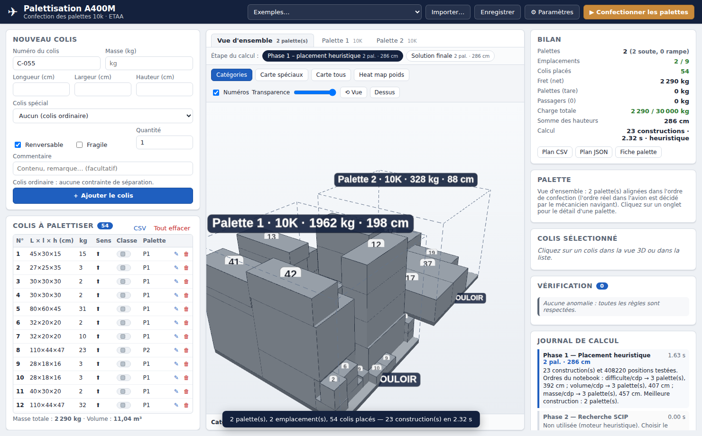
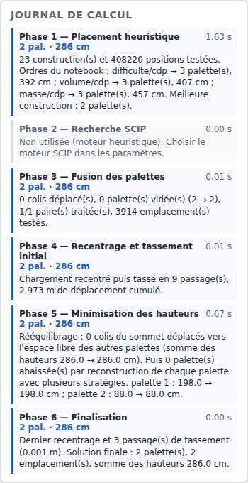

# Palettisation A400M – confection des palettes 10k

Application Windows (Python + interface web locale) qui aide les agents du transit aérien de l'ETAA à
**confectionner les palettes 10k d'un A400M** : saisie des colis, répartition automatique sur le minimum de
palettes en respectant les contraintes du projet, visualisation 3D interactive, fiches palette imprimables.

Le moteur de calcul suit le **pipeline du notebook `CDP_1`** (heuristique → SCIP → fusion → recentrage et
tassement → hauteurs → finalisation) auquel s'ajoutent les règles métier du projet (matières dangereuses,
colis lourds/légers, sens obligatoire, BIPAL…).


## Sommaire

1. [Fonctionnalités](#fonctionnalités)
2. [Installation et lancement](#installation-et-lancement)
3. [Utilisation](#utilisation)
4. [Règles et contraintes prises en compte](#règles-et-contraintes-prises-en-compte)
5. [Le pipeline en six phases](#le-pipeline-en-six-phases)
6. [Correspondance avec le notebook CDP_1](#correspondance-avec-le-notebook-cdp_1)
7. [Architecture du code](#architecture-du-code)
8. [Tests](#tests)
9. [Limites et pistes d'amélioration](#limites-et-pistes-damélioration)

---

## Fonctionnalités

| Demande | Réalisation |
|---|---|
| Saisie simple d'un colis | Formulaire : numéro, longueur / largeur / hauteur (cm), masse (kg), case **Renversable**, menu déroulant **Colis spécial** (classes IATA : explosifs, carburant, gaz, comburants, corrosifs, radioactifs… + armement), commentaire libre (vide par défaut), case **Fragile**, quantité. |
| Import des listes MEAT / SILRIA | Import CSV (séparateur `;` `,` ou tabulation, noms de colonnes reconnus automatiquement) et JSON ; export CSV de la liste. |
| Répartition des colis | Pipeline en six phases du notebook CDP_1 : minimise les emplacements, puis les hauteurs, puis recentre. Fonctionne **sans solveur** (heuristique, quelques secondes) ou **avec SCIP** (moteur exact facultatif, amorcé par l'heuristique). |
| Colis lourd jamais sur colis léger | Contrainte dure dans toutes les phases : un colis ne repose que sur des colis au moins aussi lourds que lui (facteur paramétrable). |
| Colis incompatibles | Tableau IATA 9.3.A (éditable dans `data/iata_9_3_A.json`) + séparation arme / pièce de sécurité : jamais sur la même palette ; avertissement « à ne pas charger côte à côte » entre palettes pour le mécanicien navigant. |
| Colis à sens obligatoire | Case « Renversable » décochée : le colis n'est jamais couché ni retourné (seule la rotation autour de la verticale est permise). |
| Colis plus grands qu'une palette | Création automatique d'une **BIPAL** (2 palettes accouplées, 2,74 × 4,48 m) ou d'une **TRIPAL** ; au-delà, le colis est signalé « à charger en vrac ». |
| Visualisation 3D | Three.js, rotation / zoom / déplacement à la souris, **clic sur un colis** → numéro, dimensions, masse, orientation posée, position, colis porteurs et portés, taux de support. Vue d'ensemble ou palette par palette, vue de dessus, transparence. |
| Code couleur | Mode **Catégories** : colis ordinaires en gris, une couleur par classe de colis spécial (légende). |
| Heat map | Mode **Heat map poids** : couleur du colis proportionnelle à sa masse (échelle commune à toutes les palettes). |
| « Raisonnement des cartes » | Modes **Carte spéciaux** / **Carte tous** : deux colis en contact n'ont jamais la même couleur (coloriage du graphe de contact par l'algorithme DSatur, comme les régions frontalières d'une carte). |
| Comparer les étapes du calcul | Comme les trois visualisations du notebook (*avant SCIP*, *après SCIP*, *finale*) : un sélecteur d'**étape** affiche en 3D le placement heuristique, le résultat de SCIP et la solution finale. |
| Journal de calcul | Durée, palettes et somme des hauteurs de chacune des six phases, avec le détail (constructions testées, colis transférés, statuts SCIP…). Un clic sur une phase affiche l'état correspondant. |
| Exemple du notebook | Menu **Exemples…** → « CDP – 54 colis du notebook » (colis, palettes 7 + 2 et paramètres du notebook) ou un jeu mixte avec matières dangereuses, armement et BIPAL. |
| Autres éléments issus des documents | Largeur utile réduite à 2,34 m côté couloir (dérogation possible), colis IATA placés contre une face côté couloir (étiquette accessible), palettes rampe limitées à 3 t, emplacements selon le nombre de passagers (table « Version A400M »), masse totale avion (fret + tare + passagers 90 kg + bagages 40 kg), fiche palette imprimable avec plan de dessus, vérification indépendante du plan (erreurs / avertissements cliquables), enregistrement du projet. |


## Installation et lancement

### Sur Windows, depuis les sources

1. Installer **Python 3.10 ou plus récent** depuis <https://www.python.org> (cocher *Add python.exe to PATH*).
2. Double-cliquer sur **`lancer.bat`** : il crée un environnement virtuel, installe `pywebview` et ouvre l'application dans une fenêtre native (WebView2 / Edge, présent sur Windows 10 et 11).

   En ligne de commande :

   ```bat
   python -m venv .venv
   .venv\Scripts\pip install -r requirements.txt
   .venv\Scripts\python main.py
   ```

Options : `python main.py --navigateur` ouvre l'interface dans le navigateur par défaut ; `--port 8765` fixe le port ; `--serveur` démarre seulement le serveur local.

### Exécutable Windows autonome

Double-cliquer sur **`build_windows.bat`** (ou `python -m PyInstaller PaletteA400M.spec`). L'exécutable et ses ressources sont produits dans `dist\PaletteA400M\` ; copier ce dossier complet sur le poste cible et lancer `PaletteA400M.exe`. Aucune connexion internet n'est nécessaire (Three.js est embarqué dans `ui/vendor/`). Pour embarquer aussi SCIP, faire `pip install pyscipopt` dans l'environnement avant de construire.

### Moteur SCIP (facultatif)

`pip install pyscipopt` rend disponible le moteur **« Heuristique + SCIP »** dans *Paramètres → Calcul*. Sans ce paquet l'application fonctionne normalement avec le moteur heuristique.

## Utilisation

1. **Saisir les colis** dans le formulaire de gauche (ou *Exemples…*, ou *Importer…* un CSV / un projet JSON). La liste est conservée automatiquement d'une session à l'autre.
2. **Paramètres** (⚙) : nombre de passagers, dérogation largeur 2,74 m, hauteur maximale, masses limites, règles (support minimal, facteur masse, colis IATA au bord), moteur, budget de l'heuristique, temps SCIP par étape.
3. **Confectionner les palettes** : le plan apparaît en 3D. Onglets : vue d'ensemble / palette par palette. Boutons de mode : *Catégories*, *Carte spéciaux*, *Carte tous*, *Heat map poids*. Barre **Étape du calcul** : *Phase 1 – placement heuristique*, *Phase 2 – après SCIP* (moteur SCIP), *Solution finale*.
4. **Cliquer sur un colis** (dans la vue 3D, dans la liste ou dans un message de vérification) pour ses détails.
5. **Exports** : *Plan CSV* (une ligne par colis avec palette et position), *Plan JSON*, *Fiche palette* (imprimable, avec plan de dessus et zone de signatures), *Enregistrer* (projet JSON rechargeable). Les fichiers sont écrits dans le dossier `exports/`.

| Étape 1 – placement heuristique | Journal de calcul |
|---|---|
|  |  |

| Carte (coloriage) | Heat map de masse |
|---|---|
|  |  |

Format CSV d'import (l'ordre des colonnes est libre, les alias usuels `poids`, `long`, `larg`, `haut`, `ref`, `sscc`, `type`… sont reconnus) :

```csv
numero;longueur;largeur;hauteur;masse;renversable;classe;fragile;commentaire
C-001;80;60;50;120;oui;;non;Caisse outillage
JER-01;47;35;35;22;non;3;non;Jerrican carburant
```

Codes de classe : `1`, `1.4S`, `2.1`, `2.2`, `2.3`, `3`, `4.1`, `4.2`, `4.3`, `5.1`, `5.2`, `6.1`, `6.2`, `7`, `8`, `9`, `9L` (piles au lithium), `ARME`, `SECU` ; vide = colis ordinaire.

## Règles et contraintes prises en compte

Repère d'une palette : X = largeur (2,74 m, faces **côté couloir** en x = 0 et x = L), Y = longueur (2,24 m, sens de l'avion ; 4,48 m pour une BIPAL), Z vertical. Unités : cm et kg, coin minimal de chaque colis.

**Contraintes absolues** (erreur si violée ; contrôlées après chaque phase qui déplace des colis, puis par la vérification indépendante)

- Le colis reste dans le volume utile de la palette (largeur 2,34 m sauf dérogation, hauteur 2,00 m par défaut).
- Aucun chevauchement entre colis.
- Chaque colis repose sur le sol ou sur d'autres colis sur **au moins 90 %** de sa base (paramètre).
- **Jamais un colis lourd sur un colis plus léger** : masse du colis ≤ facteur × masse de chaque colis porteur (facteur 1,0 par défaut).
- Rien ne repose sur un colis **fragile**.
- Colis **non renversable** : la hauteur saisie reste verticale.
- **Séparation IATA** (tableau 9.3.A) et **armement** (arme ≠ pièce de sécurité) : jamais sur la même palette.
- Masse nette maximale : 4 536 kg brut − 130 kg de tare en soute, 3 000 kg brut sur la rampe ; BIPAL = 2 ×, TRIPAL = 3 ×.
- Emplacements utilisés ≤ emplacements disponibles selon les passagers (54 pax → 9, 64 → 7, 74 → 6, 84 → 5, 94 → 4, 104 → 3, 116 → 2) ; charge totale ≤ capacité indicative de l'avion.

**Préférences** (objectifs et avertissements)

- Minimiser le nombre d'emplacements puis de palettes (objectif principal), puis la somme des hauteurs, puis recentrer le chargement.
- Colis lourds en bas (terme `m·z` du score de l'heuristique), tas compact, poids réparti sur la surface.
- Colis IATA **contre une face côté couloir**, étiquette accessible : préféré par l'heuristique et jamais défait par le recentrage ni le tassement (avertissement si impossible).
- Palettes de rampe : les plus légères (3 t).
- Palettes contenant des classes incompatibles entre elles : avertissement « ne pas charger côte à côte » (le positionnement dans l'avion reste hors périmètre, comme le précise le projet).

## Le pipeline en six phases

Même enchaînement que `optimiser_palettes` du notebook. Le journal de calcul de l'interface rend compte de chaque phase.

| Phase | Ce qui se passe | Code |
|---|---|---|
| **1. Placement heuristique** | Construction par **points extrêmes** (coins du plateau, faces voisines au sol, dessus des colis). Choix de la position par un score **lexicographique** : palette déjà ouverte avant une nouvelle, hausse de hauteur minimale, colis lourds bas (`m·z`), meilleur support, tas compact, centre de masse centré, proximité du centre. Ordres d'essai : *difficulté*, *volume*, *masse* (ceux du notebook) puis d'autres variantes, dont un remplissage « le plus bas, le plus au fond » ; la meilleure construction est conservée (emplacements, palettes, colis IATA hors bord, hauteurs). | `optimisation._placement_heuristique` |
| **2. Recherche SCIP** *(moteur SCIP)* | L'heuristique est fournie comme **amorce** (solution partielle + fixation temporaire) pour que SCIP la valide, puis **réduction progressive** du nombre d'emplacements (cible = courant − 1, − 2…), chaque cible avec son budget de temps. Si SCIP ne valide pas l'amorce ou si sa solution est rejetée par le contrôle indépendant, la solution heuristique est conservée. | `moteur_scip.reduire_nombre_palettes` |
| **3. Fusion des palettes** | Pour chaque paire, les colis de la palette la moins remplie sont transférés vers la plus remplie (les plus grands d'abord) tant que tout reste valide ; une palette vidée disparaît. Le temps restant est partagé entre les paires. | `optimisation._fusionner` |
| **4. Recentrage et tassement** | Translation rigide du tas pour centrer son centre de masse, puis chaque colis (les plus lourds d'abord) **glisse vers le centre** selon x puis y, au millimètre près, tant que le chargement reste valide (jusqu'à 10 passages). | `_recentrer`, `_tasser` |
| **5. Minimisation des hauteurs** | Rééquilibrage : les colis du sommet de la palette la plus haute passent dans l'espace libre des autres si la somme des hauteurs baisse. Puis, palette par palette : SCIP (moteur SCIP : amorce reconnue puis positions libres sous la hauteur connue) ou reconstruction avec plusieurs stratégies (moteur heuristique). | `_delester`, `moteur_scip.minimiser_hauteurs_par_palette`, `_reduire_hauteurs` |
| **6. Finalisation** | Dernier recentrage et tassement, palettes de rampe ramenées en soute s'il reste de la place, tri des palettes (soute d'abord, plus lourdes en premier). | `_normaliser_zones` |

Étapes affichables dans la vue 3D : `heuristique` (fin de la phase 1), `scip` (fin de la phase 2) et `finale`.

**Exemple du notebook (54 colis, 2 290 kg, 11 m³)** : le score du notebook seul (porté dans l'application) propose 3 palettes ; la meilleure des constructions testées en trouve 2 (hauteurs 198 et 88 cm avec 4 s de budget, 198 et 67 cm avec 12 s). Avec SCIP, l'amorce est validée en 2 s environ, et la recherche d'une palette unique atteint la limite de temps sans la prouver impossible.

## Correspondance avec le notebook CDP_1

| Notebook `CDP_1` | Application |
|---|---|
| Cellule 1 : `palettes`, `colis`, `temps_limite` | `data/exemple_cdp.json` (chargé par *Exemples… → CDP*), formulaire et paramètres ; `temps_limite` → *Budget de l'heuristique* et *Temps SCIP par étape* |
| `construire_placement_heuristique` (ordres difficulté / volume / masse, `positions_candidates`, `score_position`) | `_placement_heuristique`, `_ordre_placement`, `_candidats`, `_meilleure_position` |
| `ajouter_amorce_heuristique`, `contraindre_amorce_heuristique` | `moteur_scip.ajouter_amorce_heuristique`, `contraindre_amorce_heuristique` |
| Cellules 6 à 12 : variables, orientations, capacité, symétries, non-chevauchement, gravité 90 %, hauteurs | `moteur_scip.creer_modele`, `ajouter_*` (mêmes noms qu'au notebook) |
| `minimiser_nombre_palettes` (recherche progressive) | `moteur_scip.reduire_nombre_palettes` |
| `optimiser_hauteur_une_palette`, `minimiser_hauteurs_par_palette` | `moteur_scip.optimiser_hauteur_une_palette`, `minimiser_hauteurs_par_palette` |
| `chargement_valide_apres_hauteurs` | `optimisation._charge_valide` (toutes les règles, utilisée après chaque phase) |
| `recentrer_tas_rigidement`, `tasser_colis_vers_centre` | `_recentrer`, `_tasser` |
| `fusionner_palettes_avant_hauteurs`, `normaliser_palettes_identiques` | `_fusionner`, `_normaliser_zones` |
| `optimiser_palettes` | `optimisation.optimiser` |
| `afficher_resultat` | journal de calcul (`Resultat.journal`) |
| Visualisations *avant SCIP / après SCIP / finale* | sélecteur **Étape du calcul** (`Resultat.etapes`) |

**Différences et ajouts**

- Unités et repère : le notebook travaille en mètres avec l'origine au centre de la palette et le centre des colis ; l'application en cm avec le coin minimal (conversion dans `moteur_scip`).
- Règles du projet absentes du notebook : séparation IATA et armement, colis lourd/léger, fragile, colis IATA côté couloir, BIPAL/TRIPAL, rampe, largeur réduite côté couloir. Elles sont dans l'heuristique, la fusion, le tassement, le modèle SCIP et le contrôle final.
- Le notebook s'arrête si SCIP ne valide pas l'amorce ; l'application conserve la solution heuristique et poursuit les phases 3 à 6.
- Le score de l'heuristique du notebook est conservé (variante `cdp`). Comme il répartit les colis pour limiter la hausse de hauteur, il donne souvent plus de palettes qu'un remplissage « le plus bas, le plus au fond » : les deux familles sont essayées et la meilleure est gardée.
- Le **rééquilibrage des hauteurs** (phase 5) et le pipeline **sans SCIP** n'existent pas dans le notebook.
- Contrôle indépendant : toute solution issue de SCIP est revalidée avant d'être acceptée (tolérance numérique de SCIP).

## Architecture du code

```
main.py                     point d'entrée (fenêtre pywebview ou navigateur)
lancer.bat / build_windows.bat / PaletteA400M.spec   lancement et packaging Windows
palettiseur/
  modeles.py                Colis, TypePalette, Placement, Palette, Parametres, Etape, Resultat
  iata.py                   classes de colis spéciaux, couleurs, règles de séparation
  geometrie.py              orientations, chevauchement, support, contacts
  optimisation.py           pipeline en six phases (heuristique, fusion, tassement, hauteurs)
  moteur_scip.py            phases SCIP : amorce, réduction du nombre d'emplacements, hauteurs par palette
  verification.py           contrôle indépendant du plan (erreurs / avertissements)
  coloriage.py              coloriage DSatur, bornes de la heat map
  avion.py                  emplacements selon passagers, bilan de masse
  fichiers.py               import CSV / JSON, exports
  api.py                    fonctions appelées par le serveur (exemples, sérialisation)
  serveur.py                serveur HTTP local (fichiers statiques + API JSON)
data/iata_9_3_A.json        tableau IATA 9.3.A éditable
data/exemple_cdp.json       les 54 colis du notebook CDP_1 et leurs paramètres
ui/                         interface : index.html, style.css, app.js, vue3d.js (Three.js embarqué)
tests/                      tests pytest (dont parcours complet de l'interface dans Chromium)
docs/captures/              captures d'écran
```

L'interface est une page web servie sur `127.0.0.1` uniquement ; rien ne sort du poste. Le cœur n'utilise que la bibliothèque standard de Python.

## Tests

```bash
pip install pytest            # + playwright et pyscipopt pour les tests d'interface et SCIP (ignorés sinon)
python -m pytest tests -q
```

Les tests couvrent la géométrie, le tableau IATA, chaque phase du pipeline (validité d'un chargement, fusion, tassement, recentrage, rééquilibrage, zones), l'heuristique sur des listes aléatoires (aucune erreur de vérification, y compris pour chaque état intermédiaire), l'exemple du notebook (2 palettes, sens obligatoire respecté), la vérification, le coloriage, l'import/export, le pipeline SCIP et le parcours complet de l'interface. Pour régénérer les captures : `PALETTISEUR_CAPTURES=docs/captures python -m pytest tests/test_interface.py`.

## Limites et pistes d'amélioration

- Les colis sont modélisés comme des pavés (comme les données MEAT / SILRIA) ; les formes réelles (pneus, hélices) ne sont pas traitées.
- La forme oblique des emplacements de rampe n'est pas modélisée (seulement une hauteur maximale paramétrable).
- La règle de masse est appliquée entre un colis et ses porteurs directs, pas sur la charge cumulée d'une pile.
- La résistance mécanique des colis, la stabilité dynamique en vol et l'arrimage (sangles, filet) ne sont pas calculés.
- SCIP est lent : le modèle croît comme le carré du nombre de colis (réservé aux listes de moins de 60 colis) et les phases 2 et 5 consomment chacune le temps indiqué.
- Pistes : charge cumulée par colis, priorisation CSOA des UAT, déplacement manuel d'un colis dans la vue 3D, lecture directe des exports MEAT / SILRIA, groupes de compatibilité des explosifs (9.3.2.2.5), échange de colis entre palettes dans la phase des hauteurs.

## Licence des composants tiers

Three.js (`ui/vendor/`) est distribué sous licence MIT (`ui/vendor/LICENSE-three.txt`).
