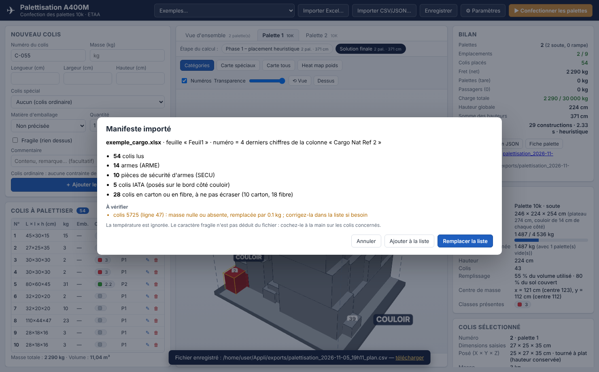
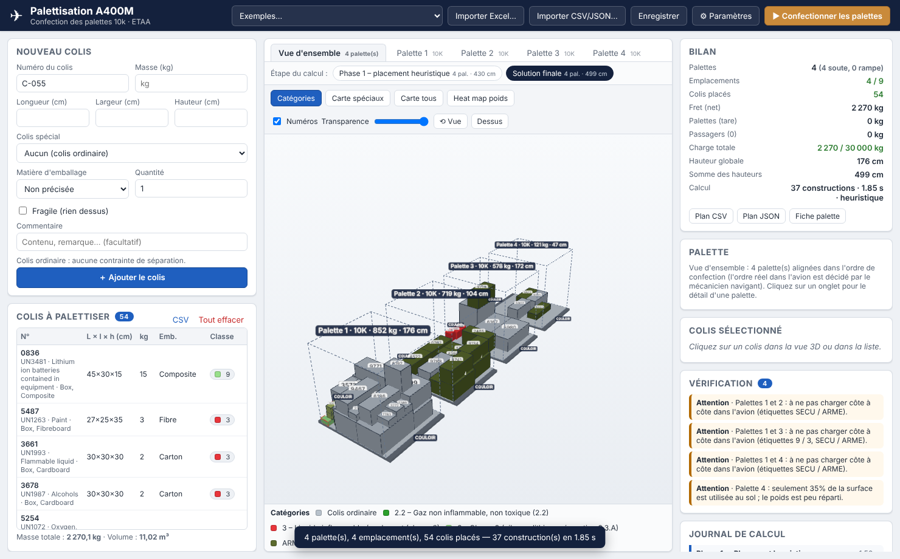

# Palettisation A400M – confection des palettes 10k

Application Windows (Python + interface web locale) qui aide les agents du transit aérien de l'ETAA à
**confectionner les palettes 10k d'un A400M** : saisie des colis, répartition automatique sur le minimum de
palettes en respectant les contraintes du projet, visualisation 3D interactive, fiches palette imprimables.

Le moteur de calcul suit le **pipeline du notebook `CDP_3`** (heuristique → SCIP → fusion → tassement vertical →
recentrage et tassement horizontal) auquel s'ajoutent les règles propres à l'application (colis lourds/légers,
fragiles, emballages en carton à ne pas écraser, armement, BIPAL…). Une palette fait **224 cm de long (sens de
l'avion) sur 274 cm de large**, avec **14 cm de couloir de chaque côté de la largeur** ; les colis dangereux sont posés
**contre l'un de ces deux bords**. Un **manifeste Excel** (format `CARGO.xlsx`) s'importe directement.


## Sommaire

1. [Fonctionnalités](#fonctionnalités)
2. [Installation et lancement](#installation-et-lancement)
3. [Utilisation](#utilisation)
4. [Règles et contraintes prises en compte](#règles-et-contraintes-prises-en-compte)
5. [Le pipeline en cinq phases](#le-pipeline-en-cinq-phases)
6. [Correspondance avec le notebook CDP_3](#correspondance-avec-le-notebook-cdp_3)
7. [Architecture du code](#architecture-du-code)
8. [Tests](#tests)
9. [Limites et pistes d'amélioration](#limites-et-pistes-damélioration)

---

## Fonctionnalités

| Demande | Réalisation |
|---|---|
| Saisie simple d'un colis | Formulaire : numéro, longueur / largeur / hauteur (cm), masse (kg), menu déroulant **Colis spécial** (classes IATA : explosifs, carburant, gaz, comburants, corrosifs, radioactifs… + armement), **matière d'emballage**, case **Fragile**, commentaire libre (vide par défaut), quantité. Plus de case « renversable » : un colis garde toujours sa hauteur à la verticale. |
| Import d'un manifeste Excel | Bouton **Importer Excel…** : lit un fichier `.xlsx` au format `CARGO.xlsx` (voir [Import Excel](#import-dun-manifeste-excel)) : armes et pièces de sécurité reconnues dans la désignation, numéro = 4 derniers chiffres de la dernière colonne, matière d'emballage lue, température ignorée. |
| Import des listes MEAT / SILRIA | Import CSV (séparateur `;` `,` ou tabulation, noms de colonnes reconnus automatiquement) et JSON ; export CSV de la liste. |
| Répartition des colis | Pipeline en cinq phases du notebook CDP_3 : minimise les emplacements, abaisse les colis par tassement vertical, puis recentre. Fonctionne **sans solveur** (heuristique, quelques secondes) ou **avec SCIP** (moteur exact facultatif, amorcé par l'heuristique). |
| Colis lourd jamais sur colis léger | Contrainte dure dans toutes les phases : un colis ne repose que sur des colis au moins aussi lourds que lui (facteur paramétrable). |
| Colis incompatibles | Tableau IATA 9.3.A (éditable dans `data/iata_9_3_A.json`) + séparation arme / pièce de sécurité : jamais sur la même palette ; avertissement « à ne pas charger côte à côte » entre palettes pour le mécanicien navigant. |
| Colis dangereux sur le bord | Règle de CDP_3 sur l'axe du couloir : un colis IATA est **posé contre l'un des deux bords côté couloir** (x = 0 ou x = largeur utile) et reste **visible depuis ce côté** ; un autre colis ne le masque que si leurs projections se chevauchent en y et en z et qu'il le dépasse en x. Contour rouge en 3D, bord et côté d'accès indiqués dans le détail du colis. L'option « Colis IATA posés sur le bord » des paramètres peut être décochée (visibilité seule). |
| Cartons non écrasés | Un colis dont l'emballage est en carton ou en fibre (« Box, Fibreboard ») ne porte rien par défaut. Le réglage « Charge maximale sur ces matières » autorise une charge limitée, et la liste « Matières à ne pas écraser » se modifie dans les paramètres (voir [Emballages](#emballages-et-cartons)). |
| Colis fragile | Seule option conservée : rien ne repose sur un colis fragile. |
| Colis plus grands qu'une palette | Création automatique d'une **BIPAL** (2 palettes accouplées, 2,74 × 4,48 m) ou d'une **TRIPAL** ; au-delà, le colis est signalé « à charger en vrac ». |
| Visualisation 3D | Three.js, rotation / zoom / déplacement à la souris, **clic sur un colis** → numéro, dimensions, masse, orientation posée, position, colis porteurs et portés, taux de support. Vue d'ensemble ou palette par palette, vue de dessus, transparence. |
| Code couleur | Mode **Catégories** : colis ordinaires en gris, une couleur par classe de colis spécial (légende). |
| Heat map | Mode **Heat map poids** : couleur du colis proportionnelle à sa masse (échelle commune à toutes les palettes). |
| « Raisonnement des cartes » | Modes **Carte spéciaux** / **Carte tous** : deux colis en contact n'ont jamais la même couleur (coloriage du graphe de contact par l'algorithme DSatur, comme les régions frontalières d'une carte). |
| Comparer les étapes du calcul | Comme les trois visualisations du notebook (*avant SCIP*, *après SCIP*, *finale*) : un sélecteur d'**étape** affiche en 3D le placement heuristique, le résultat de SCIP et la solution finale. |
| Journal de calcul | Durée, palettes et somme des hauteurs de chacune des cinq phases, avec le détail (constructions testées, colis transférés, statuts SCIP…). Un clic sur une phase affiche l'état correspondant. |
| Exemple du notebook | Menu **Exemples…** → « CDP – 54 colis du notebook » (colis dont 5 dangereux, palettes 7 + 2 de 2,54 m de haut et paramètres du notebook) ou un jeu mixte avec matières dangereuses, armement et BIPAL. |
| Autres éléments issus des documents | Palette de 274 × 224 cm avec 14 cm de couloir de chaque côté de la largeur, soit 246 cm utiles (dérogation possible), palettes rampe limitées à 3 t, emplacements selon le nombre de passagers (table « Version A400M »), masse totale avion (fret + tare + passagers 90 kg + bagages 40 kg), fiche palette imprimable avec plan de dessus, vérification indépendante du plan (erreurs / avertissements cliquables), enregistrement du projet. |


## Installation et lancement

### Sur Windows, depuis les sources

1. Installer **Python 3.10 ou plus récent** depuis <https://www.python.org> (cocher *Add python.exe to PATH*).
2. Double-cliquer sur **`lancer.bat`** : il crée un environnement virtuel, installe `pywebview` et ouvre l'application dans une fenêtre native (WebView2 / Edge, présent sur Windows 10 et 11).

   En ligne de commande :

   ```bat
   python -m venv .venv
   .venv\Scripts\pip install -r requirements.txt
   .venv\Scripts\python main.py
   ```

Options : `python main.py --navigateur` ouvre l'interface dans le navigateur par défaut ; `--port 8765` fixe le port ; `--serveur` démarre seulement le serveur local.

### Exécutable Windows autonome

Double-cliquer sur **`build_windows.bat`** (ou `python -m PyInstaller PaletteA400M.spec`). L'exécutable et ses ressources sont produits dans `dist\PaletteA400M\` ; copier ce dossier complet sur le poste cible et lancer `PaletteA400M.exe`. Aucune connexion internet n'est nécessaire (Three.js est embarqué dans `ui/vendor/`). Pour embarquer aussi SCIP, faire `pip install pyscipopt` dans l'environnement avant de construire.

### Moteur SCIP (facultatif)

`pip install pyscipopt` rend disponible le moteur **« Heuristique + SCIP »** dans *Paramètres → Calcul*. Sans ce paquet l'application fonctionne normalement avec le moteur heuristique.

## Utilisation

1. **Saisir les colis** dans le formulaire de gauche (ou *Exemples…*, ou *Importer Excel…* un manifeste, ou *Importer CSV/JSON…*). La liste est conservée automatiquement d'une session à l'autre.
2. **Paramètres** (⚙) : nombre de passagers, dimensions de la palette (224 × 274 cm), espace de couloir par côté (14 cm), dérogation sans couloir, hauteur maximale, masses limites, règles (support minimal, facteur masse, colis IATA sur le bord, matières à ne pas écraser et charge tolérée dessus), moteur, budget de l'heuristique, temps SCIP par étape.
3. **Confectionner les palettes** : le plan apparaît en 3D. Onglets : vue d'ensemble / palette par palette. Boutons de mode : *Catégories*, *Carte spéciaux*, *Carte tous*, *Heat map poids*. Barre **Étape du calcul** : *Phase 1 – placement heuristique*, *Phase 2 – après SCIP* (moteur SCIP), *Solution finale*.
4. **Cliquer sur un colis** (dans la vue 3D, dans la liste ou dans un message de vérification) pour ses détails.
5. **Exports** : *Plan CSV* (une ligne par colis avec palette et position), *Plan JSON*, *Fiche palette* (imprimable, avec plan de dessus et zone de signatures), *Enregistrer* (projet JSON rechargeable). Les fichiers sont écrits dans le dossier `exports/`.

| Étape 1 – placement heuristique | Journal de calcul |
|---|---|
|  |  |

| Carte (coloriage) | Heat map de masse |
|---|---|
|  |  |

Format CSV d'import (l'ordre des colonnes est libre, les alias usuels `poids`, `long`, `larg`, `haut`, `ref`, `sscc`, `type`… sont reconnus) :

```csv
numero;longueur;largeur;hauteur;masse;classe;fragile;emballage;reference;commentaire
C-001;80;60;50;120;;non;bois;;Caisse outillage
JER-01;47;35;35;22;3;non;plastique;;Jerrican carburant
```

Codes d'emballage : `carton`, `fibre`, `bois`, `metal`, `plastique`, `composite`, `palette` ; vide = non précisé. L'ancienne colonne `renversable` est ignorée si elle figure dans un fichier.

Codes de classe : `1`, `1.4S`, `2.1`, `2.2`, `2.3`, `3`, `4.1`, `4.2`, `4.3`, `5.1`, `5.2`, `6.1`, `6.2`, `7`, `8`, `9` (séparée comme les piles au lithium, comme dans le notebook), `9L` (ancien code, équivalent à `9`), `ARME`, `SECU` ; vide = colis ordinaire.

## Import d'un manifeste Excel

Le fichier est toujours au même format que `CARGO.xlsx` (exemple fourni : `data/exemple_cargo.xlsx`, disponible aussi dans *Exemples… → Manifeste CARGO*). Les colonnes sont retrouvées **par leur en-tête**, quel que soit leur ordre ; seule la colonne du numéro de série doit rester la dernière.

| Donnée de l'application | Colonne du manifeste | Règle |
|---|---|---|
| Numéro du colis | dernière colonne (`Cargo Nat Ref 2`) | **4 derniers chiffres** du numéro de série ; le numéro complet est conservé dans « N° de série ». Deux séries qui finissent pareil donnent `0836` puis `0836-2` (avertissement). |
| Dimensions, masse | `Length (cm)`, `Width (cm)`, `Height (cm)`, `Weight (Kg)` | Une ligne sans dimensions est ignorée et signalée. Une masse nulle devient 0,1 kg avec un avertissement (sur l'exemple : colis 5725). |
| Classe | `Class/Div` | Classe IATA lue telle quelle. Si elle est vide, la désignation (`Proper Shipping Name`) décide : **`SECU`** pour les pièces de sécurité d'armes (`SECURITY PARTS`, `WEAPONRY SECURITY`, « pièce de sécurité »…) et **`ARME`** pour les armes (`WEAPONS`, `WEAPONRY`, « arme », « armement »…). Les pièces de sécurité sont testées d'abord : « WEAPONRY SECURITY PARTS » n'est jamais prise pour une arme. Les mots-clés sont dans `data/import_cargo.json`. |
| Emballage | `Type of Packing` | `Box, Cardboard` → carton, `Box, Fibreboard` → fibre, `Box, Wood` → bois, etc. (`data/emballages.json`). |
| Fragile | – | Jamais déduit : à cocher dans la liste. |
| Température | – | **Ignorée**. |
| Commentaire | `UN/ID No`, désignation, `Sub Haz`, type d'emballage | Pour retrouver le colis ; le risque subsidiaire n'est pas utilisé pour les règles de séparation (classe principale seule, comme dans le notebook). |

Une fenêtre de résumé s'affiche avant l'import (colis lus, armes, pièces de sécurité, colis IATA, colis en carton, avertissements) avec le choix *Remplacer la liste* ou *Ajouter à la liste*. L'exemple fourni donne 54 colis, dont 14 armes, 10 pièces de sécurité et 5 colis IATA (classes 9, 3 et 2.2).



Le lecteur `.xlsx` n'a besoin d'aucune bibliothèque : il ouvre l'archive et lit le XML avec la bibliothèque standard (taille limitée, entités XML refusées). Les formats `.xls` et `.csv` d'Excel ne sont pas lus : enregistrez le fichier en `.xlsx`. Attention aux numéros de série de 18 chiffres : si Excel les a enregistrés comme des nombres, leurs derniers chiffres peuvent déjà être arrondis dans le fichier ; l'application le signale, enregistrez alors la colonne au format texte.

## Emballages et cartons

Chaque colis porte une matière d'emballage. Les matières **à ne pas écraser** sont `carton` et `fibre` par défaut (réglage « Matières à ne pas écraser » : liste de codes séparés par des virgules). Un colis dans l'une de ces matières ne porte que la **charge maximale** réglée dans les paramètres, **0 kg par défaut : rien dessus**. La règle s'applique dans toutes les phases (construction, fusion, tassements, modèle SCIP) et dans la vérification (erreur « carton »).

Ce choix coûte des palettes. Sur le manifeste d'exemple (54 colis, dont 10 en carton et 18 en fibre), mesuré avec le budget par défaut de l'heuristique :

| Réglage | Palettes |
|---|---|
| Carton et fibre protégés, rien dessus (défaut) | 4 |
| Carton seul protégé | 3 |
| Carton et fibre, 60 kg tolérés dessus | 3 |
| Aucune matière protégée | 2 |



La fibre (« fibreboard ») est traitée comme du carton par défaut : c'est une hypothèse, à modifier dans les paramètres si ces colis supportent une charge.

## Règles et contraintes prises en compte

Repère d'une palette : X = largeur (274 cm, en travers de l'avion), Y = longueur (224 cm, sens de l'avion ; 448 cm pour une BIPAL), Z vertical. **Le couloir est sur les deux côtés de la largeur** : on y laisse 14 cm de chaque côté, d'où une largeur utile de 246 cm (274 cm avec la dérogation). Les deux côtés d'accès IATA sont les extrémités de l'axe X : « gauche » (x minimal) et « droite » (x maximal). Unités : cm et kg, coin minimal de chaque colis.

**Contraintes absolues** (erreur si violée ; contrôlées après chaque phase qui déplace des colis, puis par la vérification indépendante)

- Le colis reste dans le volume utile de la palette (largeur 246 cm sauf dérogation, longueur 224 cm, hauteur 2,54 m par défaut, comme les palettes du notebook). Un colis de plus de 246 cm de large passe donc sur une BIPAL ou une TRIPAL, tourné dans le sens de la longueur.
- Aucun chevauchement entre colis.
- Chaque colis repose sur le sol ou sur d'autres colis sur **au moins 90 %** de sa base (paramètre).
- **Jamais un colis lourd sur un colis plus léger** : masse du colis ≤ facteur × masse de chaque colis porteur (facteur 1,0 par défaut).
- Rien ne repose sur un colis **fragile**.
- Un colis dans une matière **à ne pas écraser** (carton, fibre) ne porte que la charge maximale réglée (0 kg par défaut).
- La hauteur saisie reste toujours verticale : seule la rotation autour de la verticale est permise.
- **Séparation IATA** (tableau 9.3.A, mêmes 18 paires que le notebook) et **armement** (arme ≠ pièce de sécurité) : jamais sur la même palette.
- **Visibilité IATA** : chaque colis dangereux reste visible depuis le côté gauche ou le côté droit du couloir. Un autre colis le masque d'un côté s'il le dépasse de ce côté en x et que leurs projections se chevauchent en y et en z.
- **IATA sur le bord** : ce colis dangereux est de plus posé contre le bord (x = 0 ou x = largeur utile, à 0,5 cm près) du côté d'où il est visible. Les colis dangereux sont donc placés en priorité contre un bord, et les recentrages et tassements ne les en décollent jamais.
- Masse nette maximale : 4 536 kg brut − 130 kg de tare en soute, 3 000 kg brut sur la rampe ; BIPAL = 2 ×, TRIPAL = 3 ×.
- Emplacements utilisés ≤ emplacements disponibles selon les passagers (54 pax → 9, 64 → 7, 74 → 6, 84 → 5, 94 → 4, 104 → 3, 116 → 2) ; charge totale ≤ capacité indicative de l'avion.

**Préférences** (objectifs et avertissements)

- Minimiser le nombre d'emplacements puis de palettes (objectif principal), puis la somme des hauteurs, puis recentrer le chargement.
- Base la plus basse, surface couverte au sol, bandes libres préservées, tas compact (score de CDP_3), poids réparti sur la surface.
- Colis dangereux placés en premier (les plus incompatibles d'abord), contre l'un des deux bords côté couloir.
- Aucun colis isolé : un colis touche toujours un autre colis de sa palette (les tassements refusent un déplacement qui en isolerait un, la vérification émet un avertissement sinon).
- Palettes de rampe : les plus légères (3 t).
- Palettes contenant des classes incompatibles entre elles : avertissement « ne pas charger côte à côte » (le positionnement dans l'avion reste hors périmètre, comme le précise le projet).

## Le pipeline en cinq phases

Même enchaînement que `optimiser_palettes` du notebook `CDP_3`. Le journal de calcul de l'interface rend compte de chaque phase.

| Phase | Ce qui se passe | Code |
|---|---|---|
| **1. Placement heuristique** | Construction par **points extrêmes** (coins du plateau, faces voisines au sol, dessus des colis). Les colis dangereux passent d'abord, les plus incompatibles en tête. Choix de la position par un score **lexicographique** : palette déjà ouverte avant une nouvelle, distance d'un colis IATA à l'extrémité en y, base la plus basse, hauteur de la palette, surface couverte au sol, plus grande bande libre, somme des carrés des bandes libres, distance aux bords, support, compacité, centrage du centre de masse. Ordres d'essai : *grande base*, *difficulté*, *volume*, *masse* (ceux du notebook) puis d'autres variantes, dont un remplissage « le plus bas, le plus au fond ». La meilleure construction est conservée (emplacements, palettes, hauteur globale, surface au sol, somme des hauteurs). | `optimisation._placement_heuristique` |
| **2. Recherche SCIP** *(moteur SCIP)* | L'heuristique est fournie comme **amorce** (solution partielle, avec le côté d'accès de chaque colis dangereux) pour que SCIP la valide, puis **réduction progressive** du nombre d'emplacements (cible = courant − 1, − 2…). Le modèle contient les contraintes IATA du notebook : séparation des classes et choix d'un côté d'accès sans colis devant. Si SCIP ne valide pas l'amorce ou si sa solution est rejetée par le contrôle indépendant, la solution heuristique est conservée. | `moteur_scip.reduire_nombre_palettes` |
| **3. Fusion des palettes** | Pour chaque paire, les colis de la palette la moins remplie sont transférés vers la plus remplie (les plus grands d'abord) tant que tout reste valide, visibilité IATA comprise ; une palette vidée disparaît. | `optimisation._fusionner` |
| **4. Tassement vertical** | Chaque colis perché est replacé **plus bas** : autre position, autre orientation permise, tous les niveaux. Un déplacement abaisse strictement la base sans relever le sommet, et n'est accepté que si le chargement reste valide et si le retrait ne laisse aucun colis sans appui. Les affectations aux palettes ne changent pas. | `optimisation._tasser_vertical` |
| **5. Recentrage et tassement horizontal** | Translation rigide du tas pour centrer son centre de masse, puis chaque colis (les plus lourds d'abord) **glisse vers le centre** selon x puis y, au millimètre près, tant que le chargement reste valide et qu'aucun colis dangereux n'est masqué des deux côtés. Les altitudes ne changent pas. Les palettes de rampe repassent en soute s'il reste de la place. | `_recentrer`, `_tasser`, `_normaliser_zones` |

Le notebook ne minimise plus les hauteurs avec SCIP : le tassement vertical remplace cette étape. Les hauteurs sont améliorées géométriquement, sans preuve de minimum.

Étapes affichables dans la vue 3D : `heuristique` (fin de la phase 1), `scip` (fin de la phase 2) et `finale`.

**Exemple du notebook (54 colis, 2 290 kg, 11 m³, 5 colis dangereux)** : 2 palettes en 3 s environ, de 224 et 147 cm de haut, avec la largeur utile de 246 cm. Le colis 1 (classe 9) ne peut pas partager une palette avec les colis 2 à 4 (classe 3) : une seule palette est impossible. Avec SCIP, l'amorce est validée et SCIP prouve qu'une palette unique est infaisable. Le notebook, exécuté sans SCIP, donne lui aussi 2 palettes.

## Correspondance avec le notebook CDP_3

| Notebook `CDP_3` | Application |
|---|---|
| Cellule 1 : `palettes` (H = 2,54 m), `colis` avec `iata`, `temps_limite` | `data/exemple_cdp.json` (chargé par *Exemples… → CDP*), formulaire et paramètres ; `temps_limite` → *Budget de l'heuristique* et *Temps SCIP par étape* |
| `INCOMPATIBILITES_IATA`, `classes_iata_incompatibles` | `data/iata_9_3_A.json`, `iata.ReglesSeparation` (mêmes 18 paires, vérifiées par un test) |
| `cotes_accessibles_iata`, `chargement_iata_valide`, `attribuer_cotes_iata` | `geometrie.cotes_visibles`, `cotes_bord`, `optimisation._cotes_visibles`, `_cotes_bord`, `_iata_ok` ; le bord et le côté d'accès affichés viennent de `api._palettes_dict`. La règle du notebook (visibilité selon l'axe du couloir) est appliquée sur l'axe X de l'application |
| `construire_placement_heuristique` (4 ordres, `priorite_iata`, `positions_candidates`, `score_position`) | `_placement_heuristique`, `_ordre_placement`, `_candidats`, `_meilleure_position` (variante `cdp`) |
| `ajouter_contraintes_iata` | `moteur_scip.ajouter_contraintes_iata` (+ `ajouter_non_chevauchement` qui expose les variables de séparation) ; colis dangereux contre le bord par contraintes indicatrices |
| `ajouter_amorce_heuristique`, `contraindre_amorce_heuristique` | `moteur_scip.ajouter_amorce_heuristique`, `contraindre_amorce_heuristique` (avec `acces_gauche`, `acces_droite`) |
| Autres cellules du modèle : variables, orientations, capacité, symétries, gravité 90 %, hauteurs | `moteur_scip.creer_modele`, `ajouter_*` (mêmes noms qu'au notebook) |
| `minimiser_nombre_palettes` (recherche progressive) | `moteur_scip.reduire_nombre_palettes` |
| `fusionner_palettes`, `normaliser_palettes_identiques` | `_fusionner`, `_normaliser_zones` |
| `tasser_colis_verticalement` | `_tasser_vertical` |
| `recentrer_tas_rigidement`, `tasser_colis_vers_centre`, `chargement_physique_valide` | `_recentrer`, `_tasser`, `_charge_valide` (utilisée après chaque phase) |
| `optimiser_palettes` | `optimisation.optimiser` |
| `afficher_resultat` | journal de calcul (`Resultat.journal`) |
| Visualisations *avant SCIP / après SCIP / finale* (contour rouge des colis dangereux) | sélecteur **Étape du calcul** (`Resultat.etapes`), contour rouge dans la vue 3D |

**Différences et ajouts**

- Unités et repère : le notebook travaille en mètres avec l'origine au centre de la palette et le centre des colis ; l'application en cm avec le coin minimal (conversion dans `moteur_scip`). Le couloir est sur l'axe X (largeur 274 cm, 14 cm par côté) dans les deux, et les colis dangereux y sont accessibles par la gauche ou la droite.
- Règles de l'application absentes du notebook : colis lourd/léger, fragile, matières d'emballage à ne pas écraser, armement (arme / pièce de sécurité), classes IATA supplémentaires (1.4S, 6.x, 7), BIPAL/TRIPAL, rampe. Elles sont dans l'heuristique, la fusion, les tassements, le modèle SCIP et le contrôle final. La règle « lourd/léger » est la plus contraignante : sans elle, l'ordre « grande base » donne exactement les mêmes résultats que le notebook (2 palettes, 4,43 m de hauteurs cumulées) ; avec elle, il en faut 3 et l'application compense avec ses autres stratégies.
- Classe 9 : le notebook l'applique à la colonne « 9 voir 9.3.2.1.3 » du tableau (séparée des classes 1, 2.1, 3, 4.1 et 5.1). L'ancien code `9L` de l'application a le même comportement.
- Le notebook s'arrête si SCIP ne valide pas l'amorce ; l'application conserve la solution heuristique et poursuit les phases 3 à 5.
- Le tassement vertical dispose d'un quart du budget de l'heuristique, pas des 180 s du notebook : il teste moins de positions. Sur l'exemple, le notebook n'y trouve aucun replacement non plus.
- L'application essaie plus de stratégies que les quatre ordres du notebook (remplissage « le plus bas, le plus au fond », départs bruités) et garde la meilleure construction selon la clé de CDP_3.
- La phase de fusion est inchangée par rapport à `CDP_1` et peut relever la palette la plus haute : sur l'exemple, le notebook passe de 172 à 218 cm de hauteur globale. L'application a retiré son propre rééquilibrage des hauteurs, que `CDP_2` puis `CDP_3` ont remplacé par le tassement vertical.
- La tolérance de visibilité est celle de `chargement_physique_valide` (1e-7 m). La règle « posé contre le bord » utilise la tolérance de contact de l'application (0,5 cm).
- Les colis ne sont plus renversables (demande du projet) : seule la rotation autour de la verticale est permise.
- Contrôle indépendant : toute solution issue de SCIP est revalidée avant d'être acceptée (tolérance numérique de SCIP).
- Les paramètres enregistrés par une version précédente du navigateur sont ignorés (nouvelle clé de stockage), pour repartir des valeurs de `CDP_3` (palette de 224 × 274 cm, 14 cm de couloir, hauteur de 2,54 m).

## Architecture du code

```
main.py                     point d'entrée (fenêtre pywebview ou navigateur)
lancer.bat / build_windows.bat / PaletteA400M.spec   lancement et packaging Windows
palettiseur/
  modeles.py                Colis, TypePalette, Placement, Palette, Parametres, Etape, Resultat
  iata.py                   classes de colis spéciaux, couleurs, règles de séparation
  geometrie.py              orientations, chevauchement, support, contacts
  optimisation.py           pipeline en cinq phases (heuristique, fusion, tassement vertical, recentrage et tassement horizontal)
  moteur_scip.py            phase SCIP : amorce, contraintes IATA, réduction du nombre d'emplacements
  verification.py           contrôle indépendant du plan (erreurs / avertissements)
  coloriage.py              coloriage DSatur, bornes de la heat map
  avion.py                  emplacements selon passagers, bilan de masse
  fichiers.py               import CSV / JSON, exports
  import_cargo.py           lecture du manifeste Excel (colonnes, classes, numéro de série, emballage)
  lecteur_xlsx.py           lecteur .xlsx sans dépendance (zip + XML)
  emballages.py             matières d'emballage et matières à ne pas écraser
  api.py                    fonctions appelées par le serveur (exemples, sérialisation)
  serveur.py                serveur HTTP local (fichiers statiques + API JSON)
data/iata_9_3_A.json        tableau IATA 9.3.A éditable
data/exemple_cdp.json       les 54 colis du notebook (dont 5 dangereux) et leurs paramètres
data/exemple_cargo.xlsx     manifeste Excel d'exemple (54 colis dont 14 armes et 10 pièces de sécurité)
data/import_cargo.json      mots-clés armes / pièces de sécurité de l'import Excel (éditable)
data/emballages.json        matières d'emballage, mots-clés du manifeste, matières à ne pas écraser (éditable)
ui/                         interface : index.html, style.css, app.js, vue3d.js (Three.js embarqué)
tests/                      tests pytest (dont parcours complet de l'interface dans Chromium)
docs/captures/              captures d'écran
```

L'interface est une page web servie sur `127.0.0.1` uniquement ; rien ne sort du poste. Le cœur n'utilise que la bibliothèque standard de Python.

## Tests

```bash
pip install pytest            # + playwright et pyscipopt pour les tests d'interface et SCIP, openpyxl pour comparer le lecteur .xlsx (ignorés sinon)
python -m pytest tests -q
```

Les tests couvrent la géométrie, le tableau IATA, chaque phase du pipeline (validité d'un chargement, visibilité IATA, fusion, tassement vertical et horizontal, recentrage, zones), l'heuristique sur des listes aléatoires (aucune erreur de vérification, y compris pour chaque état intermédiaire), l'exemple du notebook (2 palettes), les colis dangereux sur le bord à chaque étape, le couloir de 14 cm de chaque côté, la règle des cartons, l'absence de colis isolé, le lecteur `.xlsx` (comparé à openpyxl) et l'import du manifeste, la vérification, le coloriage, l'import/export, le pipeline SCIP et le parcours complet de l'interface (dont l'import Excel). Pour régénérer les captures : `PALETTISEUR_CAPTURES=docs/captures python -m pytest tests/test_interface.py`.

## Limites et pistes d'amélioration

- Les colis sont modélisés comme des pavés (comme les données MEAT / SILRIA) ; les formes réelles (pneus, hélices) ne sont pas traitées.
- La forme oblique des emplacements de rampe n'est pas modélisée (seulement une hauteur maximale paramétrable).
- La règle de masse est appliquée entre un colis et ses porteurs directs, pas sur la charge cumulée d'une pile.
- La résistance mécanique des colis, la stabilité dynamique en vol et l'arrimage (sangles, filet) ne sont pas calculés.
- SCIP est lent : le modèle croît comme le carré du nombre de colis (réservé aux listes de moins de 60 colis) et la phase 2 consomme le temps indiqué pour chaque cible.
- Pistes : charge cumulée par colis, priorisation CSOA des UAT, déplacement manuel d'un colis dans la vue 3D, lecture directe des exports MEAT / SILRIA, groupes de compatibilité des explosifs (9.3.2.2.5), échange de colis entre palettes dans la phase des hauteurs.

## Licence des composants tiers

Three.js (`ui/vendor/`) est distribué sous licence MIT (`ui/vendor/LICENSE-three.txt`).
