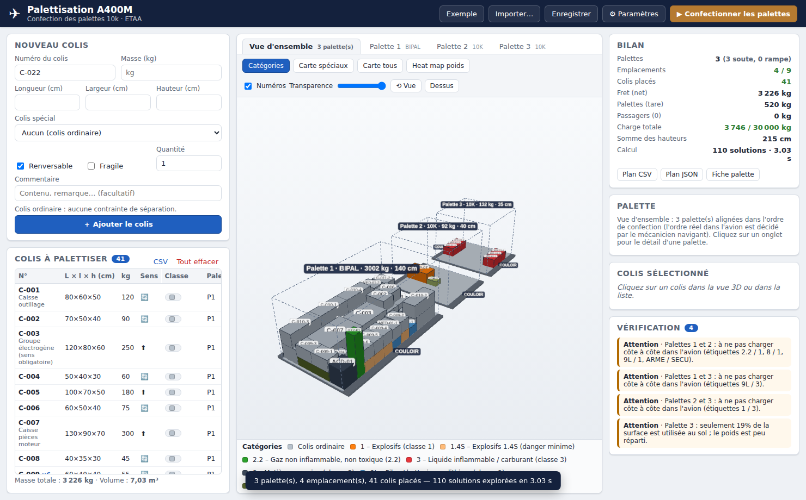
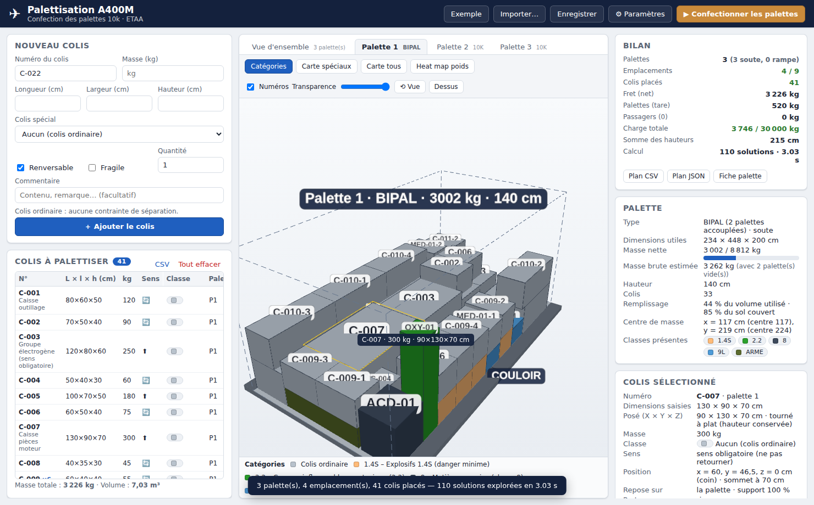
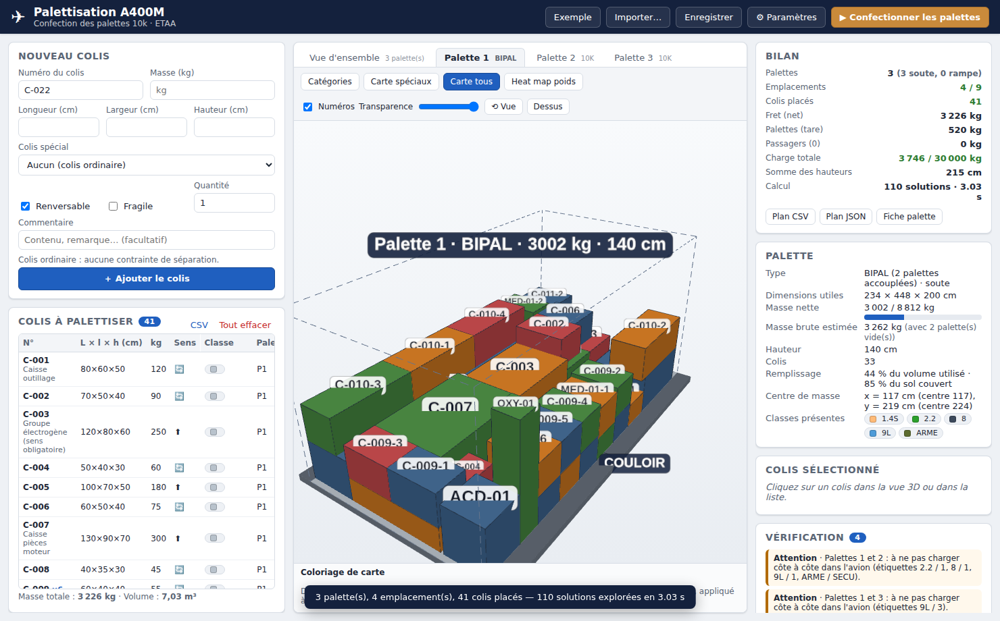
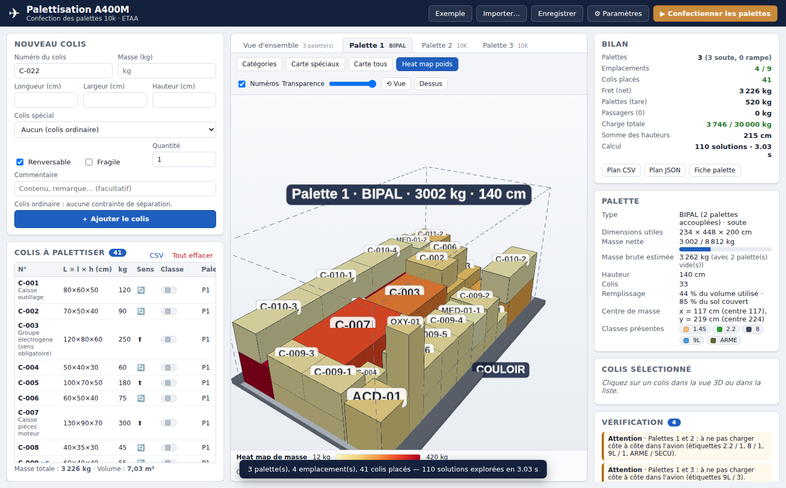

# Palettisation A400M – confection des palettes 10k

Application Windows (Python + interface web locale) qui aide les agents du
transit aérien de l'ETAA à **confectionner les palettes 10k d'un A400M** :
saisie des colis, répartition automatique sur le minimum de palettes en
respectant les contraintes du projet, visualisation 3D interactive, fiches
palette imprimables.



## Sommaire

1. [Fonctionnalités](#fonctionnalités)
2. [Installation et lancement](#installation-et-lancement)
3. [Utilisation](#utilisation)
4. [Règles et contraintes prises en compte](#règles-et-contraintes-prises-en-compte)
5. [Algorithme](#algorithme)
6. [Architecture du code](#architecture-du-code)
7. [Tests](#tests)
8. [Limites et pistes d'amélioration](#limites-et-pistes-damélioration)

---

## Fonctionnalités

| Demande | Réalisation |
|---|---|
| Saisie simple d'un colis | Formulaire : numéro, longueur / largeur / hauteur (cm), masse (kg), case **Renversable**, menu déroulant **Colis spécial** (classes IATA : explosifs, carburant, gaz, comburants, corrosifs, radioactifs… + armement), commentaire libre (vide par défaut), case **Fragile**, quantité. |
| Import des listes MEAT / SILRIA | Import CSV (séparateur `;` `,` ou tabulation, noms de colonnes reconnus automatiquement) et JSON ; export CSV de la liste. |
| Répartition des colis | Heuristique multi-départ qui minimise le nombre d'emplacements puis les hauteurs, en respectant toutes les contraintes (ci-dessous). Moteur exact SCIP facultatif pour les petites listes. |
| Colis lourd jamais sur colis léger | Contrainte dure : un colis ne peut reposer que sur des colis au moins aussi lourds que lui (facteur paramétrable). |
| Colis incompatibles | Tableau IATA 9.3.A (éditable dans `data/iata_9_3_A.json`) + séparation arme / pièce de sécurité : jamais sur la même palette ; avertissement « à ne pas charger côte à côte » entre palettes pour le mécanicien navigant. |
| Colis à sens obligatoire | Case « Renversable » décochée : le colis n'est jamais couché ni retourné (seule la rotation autour de la verticale est permise). |
| Colis plus grands qu'une palette | Création automatique d'une **BIPAL** (2 palettes accouplées, 2,74 × 4,48 m) ou d'une **TRIPAL** ; au-delà, le colis est signalé « à charger en vrac ». |
| Visualisation 3D | Three.js, rotation / zoom / déplacement à la souris, **clic sur un colis** → numéro, dimensions, masse, orientation posée, position, colis porteurs et portés, taux de support. Vue d'ensemble de toutes les palettes ou palette par palette, vue de dessus, transparence. |
| Code couleur | Mode **Catégories** : colis ordinaires en gris, une couleur par classe de colis spécial (légende). |
| Heat map | Mode **Heat map poids** : couleur du colis proportionnelle à sa masse (échelle commune à toutes les palettes). |
| « Raisonnement des cartes » | Modes **Carte spéciaux** / **Carte tous** : deux colis en contact n'ont jamais la même couleur (coloriage du graphe de contact par l'algorithme DSatur, comme les régions frontalières d'une carte). |
| Ajouts issus des documents | Largeur utile réduite à 2,34 m côté couloir (dérogation possible), colis IATA placés contre une face côté couloir (étiquette accessible), palettes rampe limitées à 3 t, nombre d'emplacements selon le nombre de passagers (table « Version A400M »), masse totale avion (fret + tare + passagers 90 kg + bagages 40 kg), fiche palette imprimable avec plan de dessus, vérification indépendante du plan (erreurs / avertissements cliquables), enregistrement du projet. |



## Installation et lancement

### Sur Windows, depuis les sources (recommandé pour le développement)

1. Installer **Python 3.10 ou plus récent** depuis <https://www.python.org> (cocher *Add python.exe to PATH*).
2. Double-cliquer sur **`lancer.bat`** : il crée un environnement virtuel, installe `pywebview` et ouvre l'application dans une fenêtre native (WebView2 / Edge, présent sur Windows 10 et 11).

   En ligne de commande :

   ```bat
   python -m venv .venv
   .venv\Scripts\pip install -r requirements.txt
   .venv\Scripts\python main.py
   ```

Options : `python main.py --navigateur` ouvre l'interface dans le navigateur par défaut ; `--port 8765` fixe le port ; `--serveur` démarre seulement le serveur local.

### Exécutable Windows autonome

Double-cliquer sur **`build_windows.bat`** (ou `python -m PyInstaller PaletteA400M.spec`). L'exécutable et ses ressources sont produits dans `dist\PaletteA400M\` ; copier ce dossier complet sur le poste cible et lancer `PaletteA400M.exe`. Aucune connexion internet n'est nécessaire (Three.js est embarqué dans `ui/vendor/`).

### Moteur exact facultatif

`pip install pyscipopt` rend disponible le moteur « SCIP » dans *Paramètres → Calcul*. Il correspond au modèle mathématique du notebook `CDP.ipynb` complété des contraintes du projet (voir plus bas).

## Utilisation

1. **Saisir les colis** dans le formulaire de gauche (ou *Exemple*, ou *Importer…* un CSV / un projet JSON). La liste est conservée automatiquement d'une session à l'autre.
2. **Paramètres** (⚙) : nombre de passagers, dérogation largeur 2,74 m, hauteur maximale, masses limites, règles (support minimal, facteur masse, colis IATA au bord), durée de recherche, moteur.
3. **Confectionner les palettes** : le plan apparaît en 3D. Onglets : vue d'ensemble / palette par palette. Boutons de mode : *Catégories*, *Carte spéciaux*, *Carte tous*, *Heat map poids*.
4. **Cliquer sur un colis** (dans la vue 3D, dans la liste ou dans un message de vérification) pour ses détails.
5. **Exports** : *Plan CSV* (une ligne par colis avec palette et position), *Plan JSON*, *Fiche palette* (imprimable, avec plan de dessus et zone de signatures), *Enregistrer* (projet JSON rechargeable). Les fichiers sont écrits dans le dossier `exports/`.

| Carte (coloriage) | Heat map de masse |
|---|---|
|  |  |

Format CSV d'import (l'ordre des colonnes est libre, les alias usuels `poids`, `long`, `larg`, `haut`, `ref`, `sscc`, `type`… sont reconnus) :

```csv
numero;longueur;largeur;hauteur;masse;renversable;classe;fragile;commentaire
C-001;80;60;50;120;oui;;non;Caisse outillage
JER-01;47;35;35;22;non;3;non;Jerrican carburant
```

Codes de classe : `1`, `1.4S`, `2.1`, `2.2`, `2.3`, `3`, `4.1`, `4.2`, `4.3`, `5.1`, `5.2`, `6.1`, `6.2`, `7`, `8`, `9`, `9L` (piles au lithium), `ARME`, `SECU` ; vide = colis ordinaire.

## Règles et contraintes prises en compte

Repère d'une palette : X = largeur (2,74 m, faces **côté couloir** en x = 0 et x = L), Y = longueur (2,24 m, sens de l'avion ; 4,48 m pour une BIPAL), Z vertical. Unités : cm et kg.

**Contraintes absolues (erreur si violée, vérifiées indépendamment de l'algorithme)**

- Le colis reste dans le volume utile de la palette (largeur 2,34 m sauf dérogation, hauteur 2,00 m par défaut).
- Aucun chevauchement entre colis.
- Chaque colis repose sur le sol ou sur d'autres colis sur **au moins 90 %** de sa base (paramètre).
- **Jamais un colis lourd sur un colis plus léger** : masse du colis ≤ facteur × masse de chaque colis porteur (facteur 1,0 par défaut).
- Rien ne repose sur un colis **fragile**.
- Colis **non renversable** : la hauteur saisie reste verticale.
- **Séparation IATA** (tableau 9.3.A, fichier `data/iata_9_3_A.json`) et **armement** (arme ≠ pièce de sécurité) : jamais sur la même palette.
- Masse nette maximale : 4 536 kg brut − 130 kg de tare en soute, 3 000 kg brut sur la rampe ; BIPAL = 2 ×, TRIPAL = 3 ×.
- Nombre d'emplacements ≤ emplacements disponibles selon les passagers (54 pax → 9, 64 → 7, 74 → 6, 84 → 5, 94 → 4, 104 → 3, 116 → 2) ; charge totale ≤ capacité indicative de l'avion.

**Préférences (objectifs de l'optimisation et avertissements)**

- Minimiser le nombre d'emplacements puis de palettes (objectif principal du projet), puis la somme des hauteurs, puis recentrer le chargement.
- Colis lourds et de forme simple **en bas** (tri des colis par masse et volume décroissants, construction couche par couche).
- Colis IATA **contre une face côté couloir**, étiquette accessible (avertissement sinon).
- Poids réparti sur la surface de la palette (avertissement si moins de 50 % du sol est couvert), colis fragile au sommet signalé (sangles).
- Palettes prévues sur la rampe : les plus légères, limitées à 3 t et à une hauteur paramétrable.
- Palettes contenant des classes incompatibles entre elles : avertissement « ne pas charger côte à côte » pour le mécanicien navigant (le positionnement dans l'avion reste hors périmètre, comme le précise le projet).

## Algorithme

Le problème est un *bin packing* 3D avec contraintes (NP-difficile). Deux moteurs :

### Heuristique multi-départ (`palettiseur/optimisation.py`) – par défaut

1. **Tri** des colis : ceux qui exigent une BIPAL/TRIPAL d'abord, puis par masse décroissante (variantes : volume, surface de base, hauteur, densité, spéciaux d'abord).
2. **Placement constructif** : pour chaque colis, on cherche dans les palettes ouvertes la meilleure position parmi des *points d'ancrage* (coins des colis déjà posés, bords de la palette) et les orientations autorisées. Le colis « tombe » sur le sommet le plus haut sous son empreinte, ce qui garantit l'absence de chevauchement ; on vérifie ensuite support ≥ 90 %, règle de masse, fragilité, hauteur, capacité, compatibilité IATA. Règles de choix : *deepest-bottom-left* (z, puis y, puis x) ou *contact maximal*, avec préférence pour les orientations à plat et pour le bord couloir des colis IATA.
3. Si aucune palette n'accepte le colis, on ouvre la plus petite palette (10k → BIPAL → TRIPAL) où il tient ; les palettes ouvertes au-delà des emplacements de soute sont des palettes rampe (3 t).
4. **Recentrage rigide** du tas sur chaque palette (translation d'ensemble, qui conserve supports et contacts).
5. **Multi-départ** : 26 stratégies déterministes puis des variantes aléatoires pendant la durée de recherche (3 s par défaut). La meilleure solution est gardée selon l'ordre lexicographique *(colis non placés, emplacements, palettes, colis IATA hors bord, somme des hauteurs, décentrage)*.

Complexité d'une construction : O(n² · orientations · ancrages) ; une soixantaine de colis se traite en quelques dizaines de millisecondes, ce qui permet d'explorer des centaines de solutions.

### Moteur exact SCIP (`palettiseur/moteur_scip.py`) – facultatif

Reprise du modèle PLNE du notebook `CDP.ipynb` (variables d'affectation, coordonnées continues, orientations binaires, non-chevauchement par indicateurs, support à 90 % par aires de contact linéarisées, hauteurs, recentrage, compacité, résolution hiérarchique en 4 étapes) auquel sont ajoutées :

- `a[i,p] + a[j,p] ≤ 1` pour chaque paire IATA / armement incompatible ;
- `contact[i,j] = 0` si `m_i > facteur · m_j` ou si `j` est fragile (le colis `i` ne peut pas reposer sur `j`) ;
- colis IATA : `x_i − l_i/2 ≤ −L/2` ou `x_i + l_i/2 ≥ L/2` (variables binaires bord gauche / droit) ;
- palettes candidates BIPAL / TRIPAL et objectif « nombre d'emplacements » pondéré.

Il prouve l'optimalité mais ne convient qu'aux petites instances (≈ 10 colis, quelques minutes).

### Coloriage « carte » (`palettiseur/coloriage.py`)

Graphe de contact (deux colis partageant une face) colorié par **DSatur** : à chaque étape on colore le colis ayant le plus de couleurs voisines distinctes avec la plus petite couleur libre. Deux voisins n'ont donc jamais la même couleur, comme deux régions frontalières.

## Architecture du code

```
main.py                     point d'entrée (fenêtre pywebview ou navigateur)
lancer.bat / build_windows.bat / PaletteA400M.spec   lancement et packaging Windows
palettiseur/
  modeles.py                Colis, TypePalette, Placement, Palette, Parametres, Resultat
  iata.py                   classes de colis spéciaux, couleurs, règles de séparation
  geometrie.py              orientations, chevauchement, support, contacts
  optimisation.py           heuristique multi-départ
  moteur_scip.py            modèle exact (facultatif, PySCIPOpt)
  verification.py           contrôle indépendant du plan (erreurs / avertissements)
  coloriage.py              coloriage DSatur, bornes de la heat map
  avion.py                  emplacements selon passagers, bilan de masse
  fichiers.py               import CSV / JSON, exports
  api.py                    fonctions appelées par le serveur
  serveur.py                serveur HTTP local (fichiers statiques + API JSON)
data/iata_9_3_A.json        tableau IATA 9.3.A éditable
ui/                         interface : index.html, style.css, app.js, vue3d.js (Three.js embarqué)
tests/                      tests pytest
docs/captures/              captures d'écran
```

L'interface est une page web servie sur `127.0.0.1` uniquement ; rien ne sort du poste. Le cœur n'utilise que la bibliothèque standard de Python, ce qui simplifie l'installation sur un poste sans internet.

## Tests

```bash
pip install pytest
python -m pytest tests -q
```

Les tests couvrent la géométrie, le tableau IATA (symétrie, paires du tableau 9.3.A, armement), l'heuristique (aucune erreur de vérification sur des instances aléatoires, règle de masse, sens obligatoire, séparation, BIPAL, vrac, capacités, rampe, bord couloir, fragiles), la vérification, le coloriage, l'import/export et le moteur SCIP (ignoré si PySCIPOpt est absent).

## Limites et pistes d'amélioration

- Les colis sont modélisés comme des pavés (comme les données MEAT / SILRIA) ; les formes réelles (pneus, hélices) ne sont pas traitées.
- La forme oblique des emplacements de rampe n'est pas modélisée (seulement une hauteur maximale paramétrable).
- La règle de masse est appliquée entre un colis et ses porteurs directs, pas sur la charge cumulée d'une pile.
- La résistance mécanique des colis, la stabilité dynamique en vol et l'arrimage (sangles, filet) ne sont pas calculés.
- Pistes : charge cumulée par colis, priorisation CSOA des UAT, déplacement manuel d'un colis dans la vue 3D, lecture directe des exports MEAT / SILRIA, groupes de compatibilité des explosifs (9.3.2.2.5).

## Licence des composants tiers

Three.js (`ui/vendor/`) est distribué sous licence MIT (`ui/vendor/LICENSE-three.txt`).
