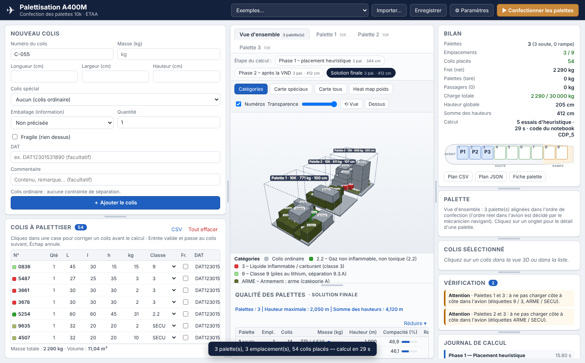
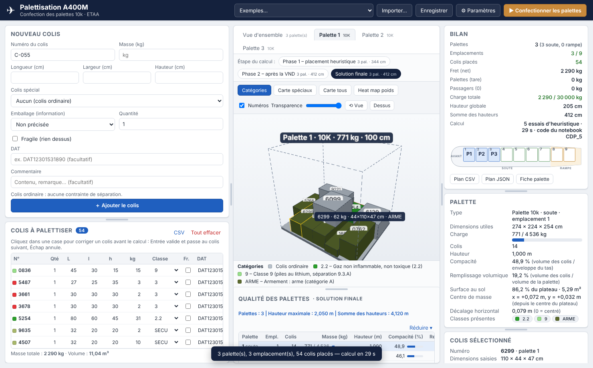
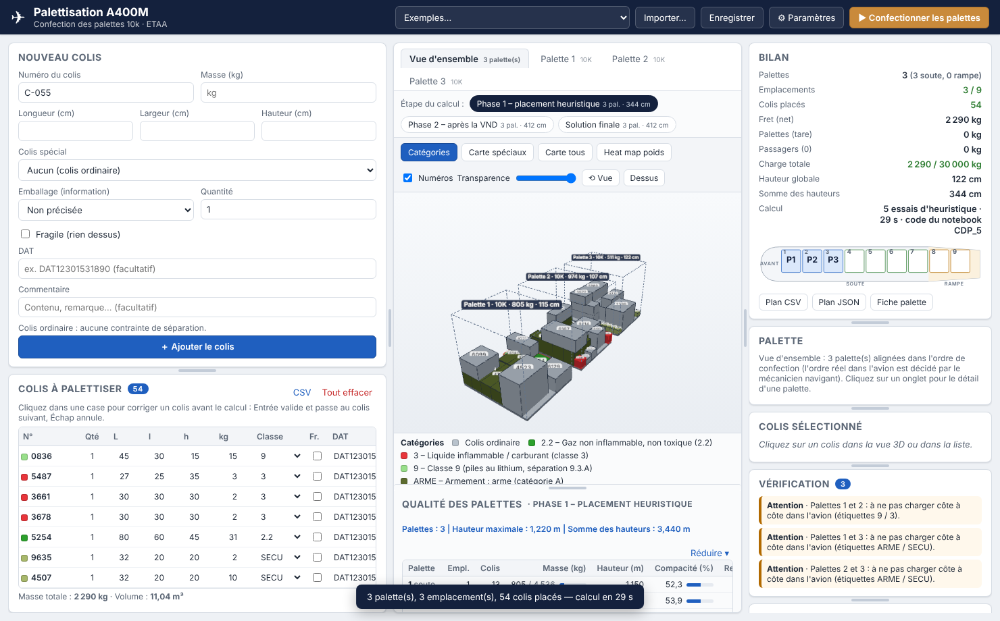
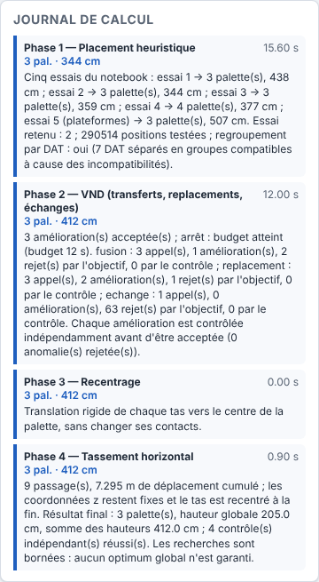
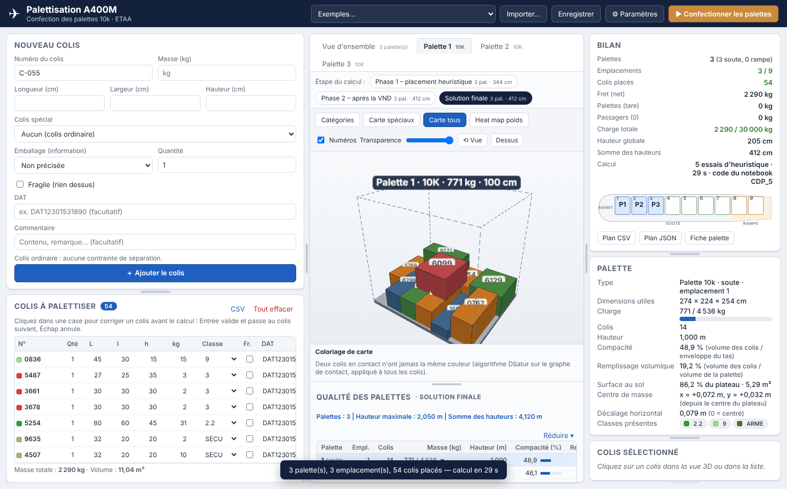
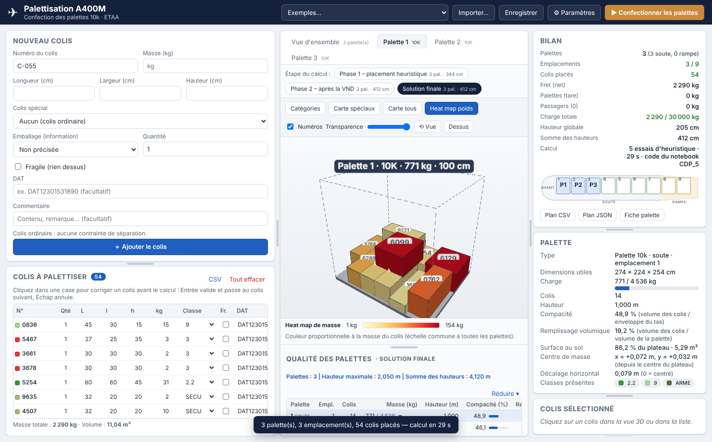
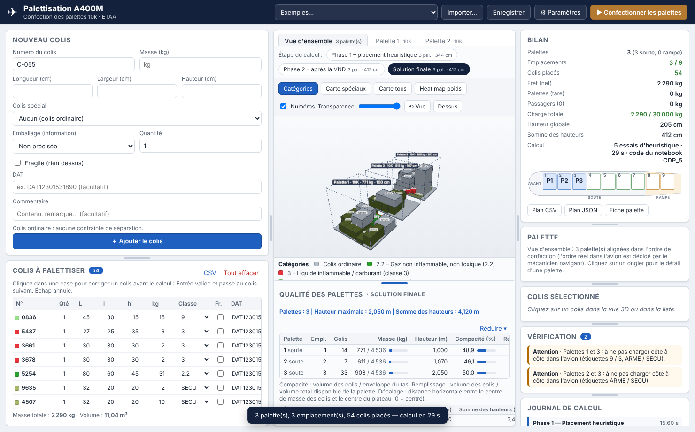
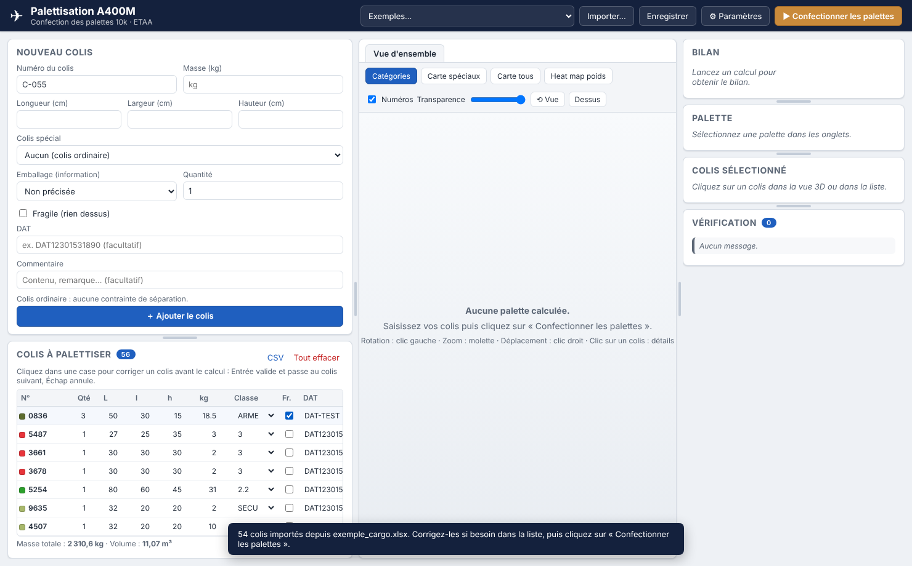
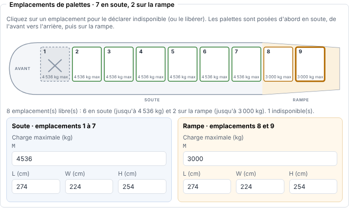
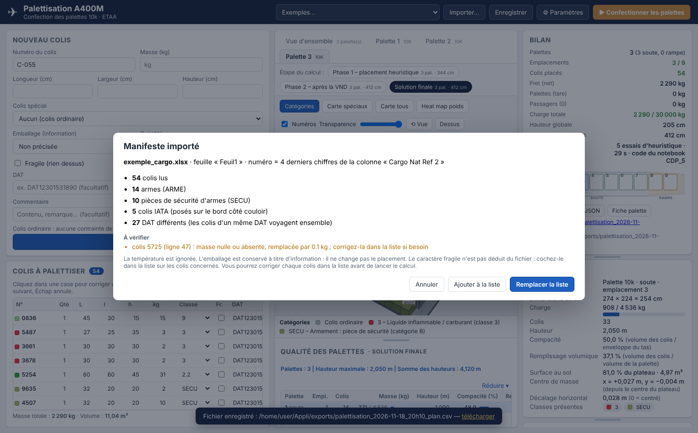

# Palettisation A400M – confection des palettes 10k

Application Windows (Python + interface web locale) qui aide les agents du transit aérien de l'ETAA à
**confectionner les palettes 10k d'un A400M** : saisie des colis, répartition automatique sur le minimum de
palettes en respectant les contraintes du projet, visualisation 3D interactive, fiches palette imprimables.

Le moteur de calcul est celui du **notebook `CDP_5`**, dont le code est repris tel quel : heuristique à cinq essais,
**VND** (transferts entre palettes, replacements plus bas, échanges), recentrage et tassement horizontal, avec un
contrôle indépendant après chaque phase. **Les paramètres par défaut sont ceux de la cellule 2 du notebook** (regroupement
par DAT, budget de 180 s, appui minimal de 80 %, marge de hauteur de 5 cm, 7 emplacements en soute de 4 536 kg et 2 sur la
rampe de 3 000 kg, tous de 2,74 × 2,24 × 2,54 m) : avec eux, l'application donne **le même résultat que le notebook**, ce
que des tests vérifient en exécutant le notebook lui-même (voir [Parité avec le notebook](#parité-avec-le-notebook)). Les
règles propres au projet (couloir de 14 cm, colis IATA contre un bord, colis lourd jamais sur un colis plus léger, fragiles)
sont des options en plus. La **matière d'emballage** n'intervient pas dans le placement, comme dans le notebook. Les colis
d'un même **DAT** voyagent ensemble et les armes et pièces de sécurité sont les catégories **A** et **B** du notebook. Un
**manifeste Excel** (format `CARGO.xlsx`) s'importe directement, et la liste des colis se corrige à la main avant le calcul.



## Sommaire

1. [Fonctionnalités](#fonctionnalités)
2. [Installation et lancement](#installation-et-lancement)
3. [Utilisation](#utilisation)
4. [Règles et contraintes prises en compte](#règles-et-contraintes-prises-en-compte)
5. [Le pipeline du notebook CDP_5](#le-pipeline-du-notebook-cdp_5)
6. [Correspondance avec le notebook CDP_5](#correspondance-avec-le-notebook-cdp_5)
7. [Architecture du code](#architecture-du-code)
8. [Tests](#tests)
9. [Limites et pistes d'amélioration](#limites-et-pistes-damélioration)

---

## Fonctionnalités

| Demande | Réalisation |
|---|---|
| Saisie simple d'un colis | Formulaire : numéro, longueur / largeur / hauteur (cm), masse (kg), menu déroulant **Colis spécial** (classes IATA : explosifs, carburant, gaz, comburants, corrosifs, radioactifs… + armement), **emballage** (information seulement), case **Fragile**, DAT, commentaire libre (vide par défaut), quantité. Plus de case « renversable » : un colis garde toujours sa hauteur à la verticale. |
| Liste modifiable | Après un import (ou une saisie), chaque colis se **corrige directement dans la liste** : numéro, quantité, longueur, largeur, hauteur, masse, classe, fragile et DAT sont des cases éditables. Entrée valide et passe au colis suivant, Échap annule ; une valeur refusée (négative, numéro déjà pris…) est expliquée et l'ancienne est conservée. Le bouton ✎ ouvre le formulaire pour le commentaire et l'emballage. Un résultat déjà affiché est marqué « à recalculer » dès qu'un colis change. |
| Panneaux redimensionnables | Des **séparateurs** se glissent à la souris (ou aux flèches du clavier) entre la colonne des colis, la vue 3D et la colonne des résultats, entre le formulaire et la liste, entre les cartes de la colonne de droite et entre la vue 3D et le tableau de qualité. Double-clic : taille d'origine. Les tailles sont mémorisées. |
| Qualité de chaque palette | Les indicateurs de la visualisation du notebook (cellules 22 et 23) : **hauteur**, **compacité** (volume des colis / boîte englobante), **remplissage volumique** (volume des colis / volume de la palette), **centre de masse** x et y et **décalage horizontal** depuis le centre du plateau, auxquels s'ajoutent la charge et la surface couverte au sol. Tableau sous la vue 3D, pour chaque étape du calcul, avec la comparaison heuristique / après la VND / solution finale. |
| Emplacements de l'avion | **7 emplacements en soute** (4 536 kg) et **2 sur la rampe** (3 000 kg), de caractéristiques différentes (charge, dimensions, hauteur). Un **plan de la soute** (paramètres et bilan) montre les emplacements libres, ceux déclarés indisponibles (un clic), ceux pris par les sièges des passagers et, après le calcul, la palette qui occupe chacun. |
| Import d'un manifeste Excel | Bouton **Importer…** (un seul pour tous les formats, reconnus à l'extension puis au contenu) : lit un fichier `.xlsx` au format `CARGO.xlsx` (voir [Import Excel](#import-dun-manifeste-excel)) : armes et pièces de sécurité reconnues dans la désignation, numéro = 4 derniers chiffres de la dernière colonne, matière d'emballage lue, température ignorée. |
| Import des listes MEAT / SILRIA | Import CSV (séparateur `;` `,` ou tabulation, noms de colonnes reconnus automatiquement) et JSON ; export CSV de la liste. |
| Répartition des colis | Pipeline de CDP_5 : cinq essais d'heuristique, VND, recentrage, tassement horizontal (voir [Le pipeline](#le-pipeline-du-notebook-cdp_5)). Le moteur **du notebook** (par défaut) exécute son code tel quel ; il est plus lent. Un **moteur rapide** de l'application (quelques secondes) est proposé et prend le relais pour les BIPAL / TRIPAL. Aucun solveur : SCIP a été retiré, comme dans le notebook. |
| Colis lourd jamais sur colis léger | Règle du projet, **désactivée par défaut** (le notebook ne l'a pas) : avec « Facteur masse dessus / dessous » = 1, un colis ne repose que sur des colis au moins aussi lourds que lui. |
| Colis incompatibles | Tableau IATA 9.3.A (éditable dans `data/iata_9_3_A.json`) + séparation arme / pièce de sécurité : jamais sur la même palette ; avertissement « à ne pas charger côte à côte » entre palettes pour le mécanicien navigant. |
| Colis à étiquette | Règle de CDP_5 (`cotes_accessibles_iata`) : un colis IATA, une arme (catégorie **A**) ou une pièce de sécurité (catégorie **B**) reste **visible depuis l'un des deux côtés** (les extrémités de l'axe y, comme dans le notebook) ; un autre colis ne le masque que si leurs projections se chevauchent sur l'autre axe et en z et qu'il le dépasse de ce côté. Option du projet, désactivée par défaut : les colis dangereux sont en plus **posés contre ce bord** (« Colis IATA posés sur le bord »). Contour rouge en 3D, bord et côté d'accès dans le détail du colis. |
| Regroupement par DAT | Les colis d'un même **DAT** (colonne « Cargo Nat Ref 1 » du manifeste) voyagent ensemble : un DAT sans conflit reste sur une palette ; un DAT contenant des classes incompatibles (arme et pièce de sécurité, par exemple) est divisé en sous-groupes compatibles, chacun indivisible. Option « Regrouper les colis d'un même DAT » (`regrouper_par_DAT` du notebook). Si les règles rendent ce regroupement impossible, le moteur le relâche et le signale. |
| Matière d'emballage | Lue dans le manifeste et affichée (liste, détail du colis, fiche palette, exports), mais **sans effet sur le placement** : le notebook ne la connaît pas (voir [Emballages](#emballages)). |
| Colis fragile | Seule option conservée : rien ne repose sur un colis fragile (case décochée par défaut : sans colis fragile, le résultat reste celui du notebook). |
| Colis plus grands qu'une palette | Création automatique d'une **BIPAL** (2 palettes accouplées, 2,74 × 4,48 m) ou d'une **TRIPAL** ; au-delà, le colis est signalé « à charger en vrac ». |
| Visualisation 3D | Three.js, rotation / zoom / déplacement à la souris, **clic sur un colis** → numéro, dimensions, masse, orientation posée, position, colis porteurs et portés, taux de support. Vue d'ensemble ou palette par palette, vue de dessus, transparence. |
| Code couleur | Mode **Catégories** : colis ordinaires en gris, une couleur par classe de colis spécial (légende). |
| Heat map | Mode **Heat map poids** : couleur du colis proportionnelle à sa masse (échelle commune à toutes les palettes). |
| « Raisonnement des cartes » | Modes **Carte spéciaux** / **Carte tous** : deux colis en contact n'ont jamais la même couleur (coloriage du graphe de contact par l'algorithme DSatur, comme les régions frontalières d'une carte). |
| Comparer les étapes du calcul | Comme les visualisations du notebook : un sélecteur d'**étape** affiche en 3D le placement heuristique, l'état après la VND et la solution finale. |
| Journal de calcul | Durée, palettes et somme des hauteurs de chaque phase (heuristique, VND, recentrage, tassement horizontal), avec le détail : les cinq essais, les voisinages de la VND (appels, améliorations, rejets), les contrôles indépendants. Un clic sur une phase affiche l'état correspondant. |
| Exemple du notebook | Menu **Exemples…** → « CDP – 54 colis du notebook » : les colis et les paramètres de CDP_5 (numéros à 4 chiffres, DAT, catégories A et B, palettes 7 + 2 de 2,54 m de haut) ; « CARGO » (le manifeste Excel avec les règles de l'application) ou un jeu mixte avec matières dangereuses, armement et BIPAL. |
| Budget de calcul | **Un seul paramètre de temps**, `temps_limite` (180 s par défaut, comme le notebook) : chaque phase de recherche peut utiliser tout le budget. Le calcul tourne en arrière-plan ; l'interface montre la phase en cours et la part du budget consommée. |
| Autres éléments issus des documents | Palette de 274 × 224 cm (couloir de 14 cm de chaque côté de l'axe des côtés en option, soit 274 × 196 cm utiles), emplacements selon le nombre de passagers (table « Version A400M »), masse totale avion (fret + tare + passagers 90 kg + bagages 40 kg), fiche palette imprimable avec plan de dessus, vérification indépendante du plan (erreurs / avertissements cliquables), enregistrement du projet. |



## Installation et lancement

### Sur Windows, depuis les sources

1. Installer **Python 3.10 ou plus récent** depuis <https://www.python.org> (cocher *Add python.exe to PATH*).
2. Double-cliquer sur **`lancer.bat`** : il crée un environnement virtuel, installe `pywebview` et ouvre l'application dans une fenêtre native (WebView2 / Edge, présent sur Windows 10 et 11).

   En ligne de commande :

   ```bat
   python -m venv .venv
   .venv\Scripts\pip install -r requirements.txt
   .venv\Scripts\python main.py
   ```

Options : `python main.py --navigateur` ouvre l'interface dans le navigateur par défaut ; `--port 8765` fixe le port ; `--serveur` démarre seulement le serveur local.

### Exécutable Windows autonome

Double-cliquer sur **`build_windows.bat`** (ou `python -m PyInstaller PaletteA400M.spec`). L'exécutable et ses ressources sont produits dans `dist\PaletteA400M\` ; copier ce dossier complet sur le poste cible et lancer `PaletteA400M.exe`. Aucune connexion internet n'est nécessaire (Three.js est embarqué dans `ui/vendor/`).

## Utilisation

1. **Saisir les colis** dans le formulaire de gauche (ou *Exemples…*, ou *Importer…* un manifeste Excel `.xlsx`, un CSV ou un projet JSON : le format est reconnu automatiquement). La liste est conservée automatiquement d'une session à l'autre.
2. **Corriger la liste** si besoin : les cases de la liste (en bas à gauche) se modifient directement. Les séparateurs entre les panneaux se déplacent pour agrandir la liste ou la vue 3D.
3. **Paramètres** (⚙), regroupés comme le notebook : *Calcul · cellule 2* (budget `temps_limite`, regroupement par DAT, support minimal, marge de hauteur du 5e essai, moteur), *Emplacements de palettes* (plan de la soute cliquable, charge et dimensions L / W / H de la soute et de la rampe), *Règles du projet* (couloir, axe des côtés, IATA sur le bord, facteur masse, tare, BIPAL / TRIPAL, tolérance de contact ; le bouton « Appliquer les règles du projet » règle le couloir à 14 cm, les colis IATA sur le bord et le facteur masse à 1) et *Avion* (passagers, masses, capacité). « Rétablir les valeurs du notebook » revient à la cellule 2.
4. **Confectionner les palettes** : une fenêtre d'avancement indique la phase en cours (la VND montre le budget consommé), puis le plan apparaît en 3D. Onglets : vue d'ensemble / palette par palette. Boutons de mode : *Catégories*, *Carte spéciaux*, *Carte tous*, *Heat map poids*. Barre **Étape du calcul** : *Phase 1 – placement heuristique*, *Phase 2 – après la VND*, *Solution finale*. Le tableau **Qualité des palettes** sous la vue 3D suit l'étape affichée.
5. **Cliquer sur un colis** (dans la vue 3D, dans la liste ou dans un message de vérification) pour ses détails.
6. **Exports** : *Plan CSV* (une ligne par colis avec palette et position), *Plan JSON*, *Fiche palette* (imprimable, avec plan de dessus et zone de signatures), *Enregistrer* (projet JSON rechargeable). Les fichiers sont écrits dans le dossier `exports/`.

| Étape 1 – placement heuristique | Journal de calcul |
|---|---|
|  |  |

| Carte (coloriage) | Heat map de masse |
|---|---|
|  |  |

| Qualité des palettes et plan de la soute | Liste de colis modifiable |
|---|---|
|  |  |



Format CSV d'import (l'ordre des colonnes est libre, les alias usuels `poids`, `long`, `larg`, `haut`, `ref`, `sscc`, `type`… sont reconnus) :

```csv
numero;longueur;largeur;hauteur;masse;classe;fragile;emballage;reference;commentaire
C-001;80;60;50;120;;non;bois;;Caisse outillage
JER-01;47;35;35;22;3;non;plastique;;Jerrican carburant
```

Codes d'emballage (information seulement) : `carton`, `fibre`, `bois`, `metal`, `plastique`, `composite`, `palette` ; vide = non précisé. L'ancienne colonne `renversable` est ignorée si elle figure dans un fichier.

Codes de classe : `1`, `1.4S`, `2.1`, `2.2`, `2.3`, `3`, `4.1`, `4.2`, `4.3`, `5.1`, `5.2`, `6.1`, `6.2`, `7`, `8`, `9` (séparée comme les piles au lithium, comme dans le notebook), `9L` (ancien code, équivalent à `9`), `ARME`, `SECU` ; vide = colis ordinaire.

## Import d'un manifeste Excel

Le fichier est toujours au même format que `CARGO.xlsx` (exemple fourni : `data/exemple_cargo.xlsx`, disponible aussi dans *Exemples… → Manifeste CARGO*). Les colonnes sont retrouvées **par leur en-tête**, quel que soit leur ordre ; seule la colonne du numéro de série doit rester la dernière.

| Donnée de l'application | Colonne du manifeste | Règle |
|---|---|---|
| Numéro du colis | dernière colonne (`Cargo Nat Ref 2`) | **4 derniers chiffres** du numéro de série ; le numéro complet est conservé dans « N° de série ». Deux séries qui finissent pareil donnent `0836` puis `0836-2` (avertissement). |
| Dimensions, masse | `Length (cm)`, `Width (cm)`, `Height (cm)`, `Weight (Kg)` | Une ligne sans dimensions est ignorée et signalée. Une masse nulle devient 0,1 kg avec un avertissement (sur l'exemple : colis 5725). |
| DAT | `Cargo Nat Ref 1` | **Chaîne complète**, sans troncature : les colis d'un même DAT voyagent ensemble (regroupement par DAT de CDP_5). |
| Classe | `Class/Div` | Classe IATA lue telle quelle. Si elle est vide, la désignation (`Proper Shipping Name`) décide : **`SECU`** pour les pièces de sécurité d'armes (`SECURITY PARTS`, `WEAPONRY SECURITY`, « pièce de sécurité »…) et **`ARME`** pour les armes (`WEAPONS`, `WEAPONRY`, « arme », « armement »…). Les pièces de sécurité sont testées d'abord : « WEAPONRY SECURITY PARTS » n'est jamais prise pour une arme. Les mots-clés sont dans `data/import_cargo.json`. |
| Emballage | `Type of Packing` | `Box, Cardboard` → carton, `Box, Fibreboard` → fibre, `Box, Wood` → bois, etc. (`data/emballages.json`). Conservé à titre d'information : **ne change pas le placement**. |
| Fragile | – | Jamais déduit : à cocher dans la liste. |
| Température | – | **Ignorée**. |
| Commentaire | `UN/ID No`, désignation, `Sub Haz`, type d'emballage | Pour retrouver le colis ; le risque subsidiaire n'est pas utilisé pour les règles de séparation (classe principale seule, comme dans le notebook). |

Une fenêtre de résumé s'affiche avant l'import (colis lus, armes, pièces de sécurité, colis IATA, DAT, avertissements) avec le choix *Remplacer la liste* ou *Ajouter à la liste*. L'exemple fourni donne 54 colis, dont 14 armes, 10 pièces de sécurité et 5 colis IATA (classes 9, 3 et 2.2).



Le lecteur `.xlsx` n'a besoin d'aucune bibliothèque : il ouvre l'archive et lit le XML avec la bibliothèque standard (taille limitée, entités XML refusées). L'ancien format `.xls` n'est pas lu (message explicite) : enregistrez le fichier en `.xlsx`. Un fichier ouvert dans Excel peut être refusé par le navigateur : fermez-le ou importez une copie. Attention aux numéros de série de 18 chiffres : si Excel les a enregistrés comme des nombres, leurs derniers chiffres peuvent déjà être arrondis dans le fichier ; l'application le signale, enregistrez alors la colonne au format texte. Après l'import, les colis se corrigent dans la liste avant le calcul (une ligne sans mesures, comme le colis 5725 de l'exemple, y est complétée à la main).

## Emballages

Chaque colis porte une matière d'emballage (`carton`, `fibre`, `bois`, `metal`, `plastique`, `composite`, `palette`), déduite de la colonne `Type of Packing` du manifeste ou choisie à la main. **Elle ne sert qu'à l'information** (liste, détail du colis, fiche palette, exports) : l'application ne place pas les colis selon leur matière et ne protège pas les cartons, car le code du notebook ne le fait pas. Une version précédente de l'application interdisait de poser quoi que ce soit sur un carton ou une fibre ; cette règle, qui écartait le résultat de celui du notebook (et coûtait une palette sur le manifeste d'exemple), est supprimée, avec ses paramètres (« Matières à ne pas écraser », « Charge maximale sur ces matières ») et l'erreur de vérification correspondante. Un test vérifie que le placement du manifeste d'exemple, avec ses 10 colis en carton, 18 en fibre et 13 en bois, est identique à celui du notebook.

La case **Fragile** reste disponible (rien ne repose sur un colis fragile) ; elle n'est jamais cochée par l'import.

## Règles et contraintes prises en compte

Repère d'une palette, celui du notebook : X = 274 cm (`L`), Y = 224 cm (`W` ; 448 cm pour une BIPAL, 672 cm pour une TRIPAL), Z vertical. **Les côtés sont les deux extrémités de l'axe des côtés**, l'axe Y par défaut : le notebook y vérifie que les colis dangereux restent visibles (« côtés de largeur », `gauche` en y minimal, `droite` en y maximal), et c'est là que l'application peut laisser **un couloir** (option « Couloir à laisser, par côté » : 14 cm dans le projet, soit une zone utile de 274 × 196 cm ; **0 par défaut**, soit 274 × 224 cm comme le notebook). Le paramètre « Côtés du couloir et des colis IATA » permet de prendre l'axe X à la place (zone utile 246 × 224 cm avec 14 cm). Pour une BIPAL ou une TRIPAL, le couloir n'est laissé qu'aux deux extrémités de l'ensemble (420 et 644 cm utiles). Unités : cm et kg, coin minimal de chaque colis.

**Règles du notebook** (toujours actives) : dimensions et charge de la palette, aucun chevauchement, appui d'au moins 80 % de la base, séparation IATA, visibilité depuis un côté, regroupement par DAT. **Règles du projet** (options, désactivées par défaut, donc sans effet sur la parité) : couloir, colis IATA contre un bord, colis lourd jamais sur un colis plus léger, rien sur un colis fragile, tare des palettes. Le bouton « Appliquer les règles du projet » des paramètres active le couloir de 14 cm, le bord des colis IATA et le facteur masse 1.

**Contraintes absolues** (erreur si violée ; contrôlées après chaque phase qui déplace des colis, puis par la vérification indépendante)

- Le colis reste dans le volume utile de la palette (274 × 224 × 254 cm par défaut, comme les palettes du notebook ; 274 × 196 cm avec un couloir de 14 cm). Un colis qui ne tient pas passe tourné, ou sur une BIPAL ou une TRIPAL s'il ne tient pas autrement.
- Aucun chevauchement entre colis.
- Chaque colis repose sur le sol ou sur d'autres colis sur **au moins 80 %** de sa base (`support_minimal`, paramètre).
- *Option du projet* : **jamais un colis lourd sur un colis plus léger** : masse du colis ≤ facteur × masse de chaque colis porteur (facteur 1,0 ; 0 = règle désactivée, valeur par défaut).
- Rien ne repose sur un colis **fragile** (aucun colis ne l'est par défaut).
- La hauteur saisie reste toujours verticale : seule la rotation autour de la verticale est permise.
- **Séparation IATA** (tableau 9.3.A, mêmes 18 paires que le notebook) et **armement** (arme ≠ pièce de sécurité) : jamais sur la même palette.
- **Visibilité IATA** : chaque colis dangereux reste visible depuis le côté gauche ou le côté droit. Un autre colis le masque d'un côté s'il le dépasse de ce côté sur l'axe des côtés et que leurs projections se chevauchent sur l'autre axe et en z.
- *Option du projet* : **IATA sur le bord** : ce colis dangereux est de plus posé contre le bord (x = 0 ou x = largeur utile, à 0,5 cm près) du côté d'où il est visible. Les colis dangereux sont donc placés en priorité contre un bord, et les recentrages et tassements ne les en décollent jamais.
- Charge maximale : 4 536 kg en soute et 3 000 kg sur la rampe (`M` de la cellule 2) ; BIPAL = 2 ×, TRIPAL = 3 × ; une tare (130 kg pour une HCU-6/E) peut être déduite, elle est de 0 par défaut.
- **Emplacements** : 7 en soute (n° 1 à 7) puis 2 sur la rampe (n° 8 et 9). Les palettes occupent d'abord les emplacements libres de la soute, de l'avant vers l'arrière, puis ceux de la rampe. Un emplacement déclaré indisponible n'est pas utilisé. Le nombre de passagers limite le total (54 pax → 9, 64 → 7, 74 → 6, 84 → 5, 94 → 4, 104 → 3, 116 → 2) et les sièges prennent les emplacements libres de l'avant (hypothèse d'implantation, à corriger à la main avec le plan). S'il faut plus de palettes que d'emplacements libres, le calcul aboutit quand même et la vérification signale le manque. Charge totale ≤ capacité indicative de l'avion.

**Préférences** (objectifs et avertissements)

- Minimiser le nombre d'emplacements puis de palettes (objectif principal), puis la somme des hauteurs, puis recentrer le chargement.
- Base la plus basse, surface couverte au sol, bandes libres préservées, tas compact (score de CDP_5), poids réparti sur la surface.
- Colis dangereux placés en premier (les plus incompatibles d'abord), contre l'un des deux bords des côtés.
- Aucun colis isolé : un colis touche toujours un autre colis de sa palette (les tassements refusent un déplacement qui en isolerait un, la vérification émet un avertissement sinon).
- Palettes de rampe (3 t) : elles ne sont ouvertes qu'après celles de la soute.
- Palettes contenant des classes incompatibles entre elles : avertissement « ne pas charger côte à côte » (le positionnement dans l'avion reste hors périmètre, comme le précise le projet).

## Le pipeline du notebook CDP_5

Même enchaînement que `optimiser_palettes` du notebook `CDP_5` (cellule 38). Le journal de calcul de l'interface rend compte de chaque phase.

| Phase | Ce qui se passe | Code du notebook |
|---|---|---|
| **1. Placement heuristique** | **Cinq essais** de construction par points extrêmes : grande base, difficulté, volume, masse, puis un essai de **plateformes** (couches partielles de hauteurs proches, regard en avance sur trois colis, marge de hauteur de 5 cm). Les colis à étiquette passent d'abord. Avec le regroupement par DAT, chaque groupe est essayé en entier sur une copie de chaque palette. Le meilleur essai est conservé selon : palettes, hauteur globale, surface au sol, somme des hauteurs, centrage. | `construire_placement_heuristique` |
| **2. VND** | *Variable Neighborhood Descent* pendant le budget indiqué : **transferts** entre palettes (groupes de DAT complets, de la palette la moins remplie vers la plus remplie), **replacements** plus bas (autre position, autre orientation) puis **échanges** de deux colis. Une amélioration acceptée relance les transferts. Le score est lexicographique : nombre de palettes, concentration du chargement, hauteur maximale, somme des hauteurs, surface au sol. Chaque proposition passe par le contrôle indépendant avant d'être acceptée. | `ameliorer_vnd`, `fusionner_palettes`, `tasser_colis_verticalement` |
| **3. Recentrage** | Translation rigide de chaque tas vers le centre de la palette, sans changer ses contacts. | `recentrer_tas_rigidement` |
| **4. Tassement horizontal** | Chaque colis (les plus lourds d'abord) glisse vers le centre selon x puis y, au millimètre, tant que le chargement reste valide ; z reste fixe ; le tas est recentré à la fin. | `tasser_colis_vers_centre` |

Après l'heuristique et après chaque phase, le **contrôle indépendant** (`controler_chargement_independant`) recalcule les contraintes depuis les entrées : masses, limites, collisions, orientations, appui minimal, accès des colis à étiquette, incompatibilités, regroupement par DAT. Si une phase échoue au contrôle, la dernière solution valide est restaurée. La VND compare les solutions par concentration avant la hauteur : une amélioration acceptée peut donc augmenter la hauteur. Les recherches sont bornées et ne garantissent pas un optimum global.

Étapes affichables dans la vue 3D : `heuristique` (fin de la phase 1), `apres_vnd` (fin de la phase 2) et `finale`.

**Exemple du notebook (54 colis, 2 290 kg, 27 DAT)** : *Exemples… → CDP* charge les colis et les paramètres de la cellule 2 de CDP_5 (274 × 224 cm sans couloir, appui minimal de 80 %, aucune règle propre à l'application) ; le budget de temps réglé n'est pas modifié. Valeurs relevées en exécutant le notebook : les cinq essais donnent 3, 3, 3, 4 et 3 palettes (4,38 / 3,44 / 3,59 / 3,77 / 5,07 m de hauteurs cumulées, 290 514 positions testées), l'essai 2 est retenu, et la VND de 30 s ramène le chargement à **2 palettes** (1,41 et 2,38 m). Le moteur de l'application retrouve exactement les cinq essais ; la VND dépend du budget de temps, donc du matériel. Avec le budget par défaut (180 s), compter 15 s d'heuristique, jusqu'à 3 minutes de VND (elle s'arrête avant si plus rien ne s'améliore) et quelques secondes de tassement.

## Correspondance avec le notebook CDP_5

| Notebook `CDP_5` | Application |
|---|---|
| Cellule 2 : `regrouper_par_DAT`, `temps_limite`, `support_minimal`, `marge_hauteur` | Paramètres *Calcul · cellule 2* : « Regrouper les colis d'un même DAT », « Budget de calcul » (180 s), « Support minimal » (80 %), « Marge de hauteur du 5e essai » (5 cm). Ce sont les valeurs par défaut. |
| Cellule 2 : `palettes` (`M`, `L`, `W`, `H`, 7 de 4 536 kg et 2 de 3 000 kg) | Paramètres *Emplacements de palettes* : 7 emplacements de soute et 2 de rampe, chacun libre ou indisponible (plan de la soute), avec la charge `M` et les dimensions `L`, `W`, `H` de chaque zone |
| Cellule 2 : `colis` | `data/exemple_cdp.json` (*Exemples… → CDP*) |
| Cellule 2, données `(id, masse, longueur, largeur, hauteur, r, IATA, DAT)` | `Colis` : `numero` (4 derniers chiffres de « Cargo Nat Ref 2 »), `dat` (« Cargo Nat Ref 1 » complet), `classe` ; `r = 1` toujours |
| Cellule 4 : catégories `A` (WEAPONS) et `B` (WEAPONRY SECURITY PARTS) | classes `ARME` et `SECU` (`iata.classe_notebook`) : visibles depuis un côté, incompatibles entre elles |
| Cellules 4 et 5 : règles IATA, `partition_DAT`, `groupes_DAT` | `palettiseur/notebook_cdp.py` (code repris tel quel) ; `geometrie.cotes_visibles`, `dat.partition` pour la vérification de l'application |
| Cellules 6 à 14 : heuristique à cinq essais | `notebook_cdp.construire_placement_heuristique` |
| Cellules 15 à 17, 25 : replacement plus bas | `notebook_cdp.tasser_colis_verticalement` |
| Cellules 18 et 26 : recentrage, tassement horizontal | `notebook_cdp.recentrer_tas_rigidement` (avec la contrainte du bord des colis IATA), `tasser_colis_vers_centre` |
| Cellules 27 à 34 : transferts entre palettes | `notebook_cdp.fusionner_palettes` |
| Cellule 35 : contrôle indépendant | `notebook_cdp.controler_chargement_independant` |
| Cellules 36 et 37 : VND | `notebook_cdp.ameliorer_vnd` |
| Cellule 38 : `optimiser_palettes` | `notebook_cdp.Contexte.executer` (mêmes contrôles et restaurations), puis `optimisation._optimiser_notebook` pour le journal |
| Cellules 22 et 23 : `calculer_indicateurs`, `afficher_indicateurs` | `indicateurs.py` et tableau « Qualité des palettes » : hauteur, compacité, remplissage volumique, centre de masse, décalage horizontal (mêmes définitions, testées contre `calculer_indicateurs`) |
| Cellules 39 à 43 : bilan et graphiques | journal de calcul, vue 3D, étapes `heuristique` / `apres_vnd` / `finale` |

**Différences et ajouts**

- Unités et repère : le notebook travaille en mètres avec l'origine au centre de la palette et le centre des colis ; l'application en cm avec le coin minimal (conversions dans `notebook_cdp`). Les axes sont les mêmes (x = 274 cm, y = 224 cm) et les côtés d'accès sont les extrémités de l'axe y ; le couloir de 14 cm est une option de l'application. L'axe x est possible : le problème est alors transposé avant d'être donné au notebook.
- **Accroches** : quatre points du code du notebook, marqués « [APPLICATION] », laissent l'application ajouter ses règles (lourd sur léger, fragile, colis IATA contre un bord, classes absentes du tableau 9.3.A). Elles sont inactives sans règles supplémentaires (réglage par défaut), et le module se comporte alors exactement comme le notebook. L'absence de colis isolé n'est pas garantie par ce moteur (la vérification la signale).
- **Catégories A et B** : comme dans le notebook, elles déclenchent l'accessibilité latérale et la préférence pour les extrémités ; l'application n'exige le bord que pour les vraies classes IATA.
- **Regroupement impossible** : si aucun des cinq essais ne peut garder chaque groupe de DAT sur une palette avec les règles demandées (par exemple couloir, colis lourd jamais sur léger et gros DAT), le notebook s'arrête. L'application relâche alors le regroupement (option `regrouper_par_DAT = False` du notebook) avant de changer de moteur, et la vérification signale les DAT répartis.
- **Relais par le moteur rapide** : le notebook ne connaît ni la BIPAL ni la TRIPAL, et son code n'est pas optimisé (au-delà de 150 colis, trop lent). Dans ces cas, ou si le moteur du notebook échoue, le moteur de l'application calcule (heuristique multi-départ, fusion, tassement vertical, recentrage, tassement horizontal ; sans regroupement par DAT) et le journal le dit.
- **Un seul budget de temps**, comme le notebook : `temps_limite` (180 s) = « Budget de calcul ». C'est le budget de la VND ; l'heuristique (15 s pour 54 colis), les contrôles, le recentrage et le tassement n'en ont pas besoin et s'y ajoutent. Le moteur rapide de l'application utilise le même paramètre : chacune de ses phases de recherche peut en utiliser la totalité (et s'arrête avant si plus rien ne s'améliore). L'ancien paramètre « Budget du moteur rapide » est supprimé.
- SCIP est retiré, comme dans le notebook : plus de moteur exact, plus de dépendance `pyscipopt`.
- Le support minimal passe de 90 % à 80 % (`support_minimal` du notebook).
- Règles de l'application absentes du notebook (toutes optionnelles, sauf les classes IATA supplémentaires et les formats BIPAL / TRIPAL, qui ne servent que si le notebook ne sait pas traiter le colis) : colis lourd/léger, fragile, bord des colis IATA, couloir, tare, classes IATA supplémentaires (1.4S, 6.x, 7), BIPAL/TRIPAL. La matière d'emballage n'est plus une règle.
- La rampe a ses propres dimensions et sa propre charge ; sa forme oblique n'est pas modélisée.
- Les paramètres enregistrés par une version précédente du navigateur sont ignorés (nouvelle clé de stockage), pour repartir des valeurs de la cellule 2.

## Parité avec le notebook

Le fichier `tests/reference/CDP_5.ipynb` est le notebook ; `tests/test_parite_notebook.py` en **exécute les cellules 2 à 39** et compare ce qu'il calcule à ce que calcule l'application avec ses paramètres par défaut :

- les entrées : paramètres, 9 palettes (7 × 4 536 kg et 2 × 3 000 kg) et 54 colis sont ceux de la cellule 2 ;
- l'heuristique sur les 54 colis : mêmes cinq essais (palettes, hauteurs, positions testées), même essai retenu, **chaque colis exactement à la même position** ;
- le même placement quand les colis viennent de l'import du manifeste Excel, avec ses 10 cartons, 18 fibres et 13 bois : la matière ne change rien ;
- le recentrage, le tassement horizontal, `calculer_indicateurs`, `score_vnd` et le contrôle indépendant, appliqués au même état ;
- le pipeline complet (heuristique, VND, recentrage, tassement) sur 30 colis, dont la VND s'arrête d'elle-même : les trois états ont les mêmes coordonnées que ceux du notebook ;
- les indicateurs de qualité affichés par l'application : mêmes valeurs que `calculer_indicateurs` ;
- une contre-épreuve : activer le couloir ou « lourd jamais sur léger » écarte le résultat de celui du notebook, d'où leur désactivation par défaut.

La VND s'arrête au bout du budget quand le problème est grand (54 colis) : son résultat dépend alors du temps et du matériel, aussi bien dans le notebook que dans l'application, et seul le nombre de palettes final peut être comparé. Sur les 54 colis, le notebook comme l'application donnent 3 palettes après l'heuristique et 2 après quelques dizaines de secondes de VND.

## Architecture du code

```
main.py                     point d'entrée (fenêtre pywebview ou navigateur)
lancer.bat / build_windows.bat / PaletteA400M.spec   lancement et packaging Windows
palettiseur/
  modeles.py                Colis, TypePalette, Placement, Palette, Parametres, Etape, Resultat
  iata.py                   classes de colis spéciaux, couleurs, règles de séparation
  geometrie.py              orientations, chevauchement, support, contacts
  optimisation.py           choix du moteur, journal et moteur rapide de l'application (heuristique multi-départ, fusion, tassements)
  dat.py                    partition des colis par DAT (vérification)
  verification.py           contrôle indépendant du plan (erreurs / avertissements)
  coloriage.py              coloriage DSatur, bornes de la heat map
  avion.py                  emplacements libres, plan de la soute, attribution des palettes aux emplacements, bilan de masse
  indicateurs.py            indicateurs de qualité d'une palette (cellules 22 et 23 du notebook)
  notebook_cdp.py           code du notebook CDP_5 repris tel quel (moteur par défaut) et sa conversion vers l'application
  fichiers.py               import CSV / JSON, exports
  import_cargo.py           lecture du manifeste Excel (colonnes, classes, numéro de série, emballage)
  lecteur_xlsx.py           lecteur .xlsx sans dépendance (zip + XML)
  emballages.py             matières d'emballage (information)
  api.py                    fonctions appelées par le serveur (exemples, sérialisation, calcul en arrière-plan)
  serveur.py                serveur HTTP local (fichiers statiques + API JSON)
data/iata_9_3_A.json        tableau IATA 9.3.A éditable
data/exemple_cdp.json       les 54 colis du notebook (dont 5 dangereux) et leurs paramètres
data/exemple_cargo.xlsx     manifeste Excel d'exemple (54 colis dont 14 armes et 10 pièces de sécurité)
data/import_cargo.json      mots-clés armes / pièces de sécurité de l'import Excel (éditable)
data/emballages.json        matières d'emballage et mots-clés du manifeste (éditable)
ui/                         interface : index.html, style.css, app.js, vue3d.js (Three.js embarqué), separateurs.js (panneaux
                            redimensionnables), plan_soute.js (plan de la soute)
tests/                      tests pytest (dont parcours complet de l'interface dans Chromium)
tests/reference/CDP_5.ipynb le notebook de référence, exécuté par les tests de parité
docs/captures/              captures d'écran
```

L'interface est une page web servie sur `127.0.0.1` uniquement ; rien ne sort du poste. Le cœur n'utilise que la bibliothèque standard de Python.

## Tests

```bash
pip install pytest            # + playwright pour les tests d'interface, openpyxl pour comparer le lecteur .xlsx (ignorés sinon)
python -m pytest tests -q
```

Les tests couvrent la géométrie, le tableau IATA, chaque phase du pipeline (validité d'un chargement, visibilité IATA, fusion, tassement vertical et horizontal, recentrage, zones), l'heuristique sur des listes aléatoires (aucune erreur de vérification, y compris pour chaque état intermédiaire, avec et sans les règles du projet), la **parité avec le notebook** (voir [ci-dessus](#parité-avec-le-notebook) : le notebook est exécuté et comparé position par position), le regroupement par DAT (groupes compatibles, DAT conflictuels, regroupement relâché), les catégories A et B, les deux axes des côtés, les colis dangereux sur le bord à chaque étape, le couloir, la matière d'emballage sans effet, les emplacements et le plan de la soute, les indicateurs de qualité, l'absence de colis isolé, le lecteur `.xlsx` (comparé à openpyxl) et l'import du manifeste, la vérification, le coloriage, l'import/export, le calcul en arrière-plan, le moteur rapide de l'application, le relais vers lui et l'interface dans Chromium (parcours complet avec import Excel, liste modifiable, séparateurs, plan de la soute, avancement du calcul). Compter environ 4 minutes pour toute la suite : le notebook n'est pas optimisé (15 s pour l'heuristique des 54 colis, exécutée plusieurs fois) et le parcours d'interface calcule plusieurs plans. Pour régénérer les captures : `PALETTISEUR_CAPTURES=docs/captures python -m pytest tests/test_interface.py`.

## Limites et pistes d'amélioration

- Les colis sont modélisés comme des pavés (comme les données MEAT / SILRIA) ; les formes réelles (pneus, hélices) ne sont pas traitées.
- La forme oblique des emplacements de rampe n'est pas modélisée (seulement des dimensions, une hauteur et une charge propres à la rampe).
- Les sièges des passagers sont supposés prendre les emplacements de l'avant de la soute ; le plan permet de corriger cette hypothèse en déclarant des emplacements indisponibles.
- Le plan de la soute est schématique : il numérote les emplacements dans l'ordre où les palettes les occupent, sans position exacte dans l'avion (« le positionnement reste hors périmètre »).
- La règle de masse est appliquée entre un colis et ses porteurs directs, pas sur la charge cumulée d'une pile.
- La résistance mécanique des colis, la stabilité dynamique en vol et l'arrimage (sangles, filet) ne sont pas calculés.
- Le moteur du notebook n'est pas optimisé : environ 15 s pour l'heuristique de 54 colis, plus le budget de la VND (180 s par défaut, à réduire dans les paramètres pour un essai rapide) ; le calcul ne peut pas être interrompu en cours de route ; au-delà de 150 colis, ou avec des BIPAL / TRIPAL, le moteur rapide de l'application prend le relais.
- Les échanges de la VND sont des essais bornés par le budget : le résultat dépend du temps accordé et du matériel, pas seulement des données.
- Pistes : charge cumulée par colis, priorisation CSOA des UAT, déplacement manuel d'un colis dans la vue 3D, lecture directe des exports MEAT / SILRIA, groupes de compatibilité des explosifs (9.3.2.2.5), accélérer le code du notebook.

## Licence des composants tiers

Three.js (`ui/vendor/`) est distribué sous licence MIT (`ui/vendor/LICENSE-three.txt`).
